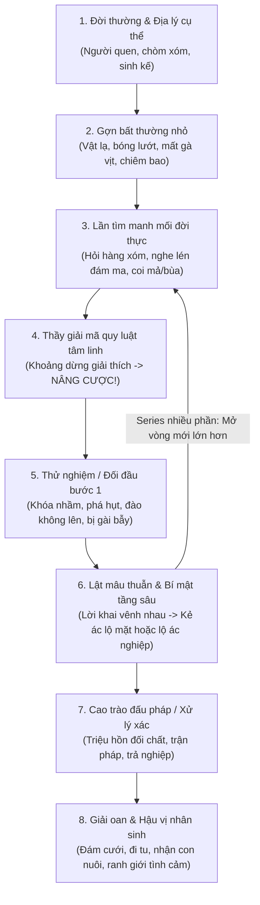

# 01. Cấu Trúc Tự Sự, Nhịp Điệu & Kỹ Thuật Dẫn Truyện — CHUYỆN MA CHÚ 3 DUY

> **Phạm vi dữ liệu & phương pháp:** Báo cáo này được rút trích từ hệ thống thống kê toàn bộ **528 tập truyện đầy đủ** (`>= 500` từ, tổng `5.524.851` từ / `387,9` giờ âm thanh, lọc trùng theo `video_id`) kết hợp đọc sâu **16 kịch bản/bản chép lời đại diện** phủ đủ cả 4 giai đoạn phát triển kênh (từ Tập 1 tới Tập 618) và mọi định dạng:
> - **Truyện ngắn lẻ & tiến hóa đầu kênh:** Tập 1 (*Vong Nữ Trong Quán Trà Sữa Ở Cần Thơ*), Tập 391 (*Mẹ Chồng Ma Da*), Tập 454 (*Quỷ Ăn Hồn Thầy Bói*), Tập 471 (*Oan Tình Giải Thoát [Thầy 7]* — Tập đặc biệt 1 triệu sub).
> - **Series nhiều phần:** *Báo Thù Án Mạng* (Tập 427 P1, 429 P3, 430 Phần cuối), *Cô Dâu Tễ Xác* (Tập 500 P1, 502 P3, 504 Phần cuối), *Linh Nữ Đầu Thai* (Tập 597 P1, 600 P4, 603 P7, 604 Phần cuối), và *Quỷ Ngãi Ma Lai* (Tập 606 P1, 612 P7, 618 P13).
>
> **Lưu ý về dữ liệu ASR (`vi.txt`):** Bản chép lời tự động của YouTube có lỗi nhận diện âm Nam Bộ (ví dụ: `dong hồn` thay vì `vong hồn`, `cắn lữ` thay vì `cắn lưỡi`, `mã` thay vì `mả`, `trầu cao` thay vì `trầu cau`, `đám cứ` thay vì `đám cưới`, `cung cùi` thay vì `cuối cùng`). Mọi trích dẫn nguyên văn dưới đây giữ nguyên nhịp nói tự nhiên và chú thích `[chuẩn âm: ...]` khi có lỗi ASR — **tuyệt đối không nhầm lỗi ASR là chính tả phương ngữ**.

---

## 1. Phân Loại Định Dạng & Đường Cong Nhịp Điệu (Format Taxonomy & Pacing Curves)

### 1.1. Tốc độ kể chuẩn & công thức quy đổi Thời lượng ↔ Số từ

Đo đạc trên toàn bộ 528 tập đầy đủ cho thấy tốc độ kể chuyện của Chú Ba Duy cực kỳ ổn định:

- **Tốc độ nói trung vị (Median Speaking Rate):** **`240,4` từ/phút** (khoảng tứ phân vị IQR: `229,4 – 252,8` từ/phút; trung bình: `244,1` từ/phút).
- **Quy tắc quy đổi khi viết kịch bản thoại (Word-to-Minute Budget):**
  - `1 phút kể` ≈ **`240` từ tiếng Việt** (tính theo âm tiết/từ đơn tách bằng khoảng trắng).
  - `5 phút` ≈ `1.200` từ | `15 phút` ≈ `3.600` từ | `40 phút` ≈ `9.600` từ | `60 phút` ≈ `14.400` từ.
  - **Luật nén – giãn theo cao trào:** Ở các đoạn kể đời thường và giải thích lịch sử/đạo pháp, nhịp nói trôi đều (`~235–245` từ/phút). Khi vào cảnh rượt đuổi, nhập hồn, hoặc đối chất gấp gáp, câu bị cắt ngắn thành chuỗi động từ liên hoàn (tăng cảm giác tốc độ dù số từ/phút vẫn giữ quanh `250`).

### 1.2. Bốn định dạng cấu trúc chính & ngân sách từ/phút

| Định dạng (Format) | Số tập trong kho (`n=528`) | Thời lượng trung vị (IQR) | Số từ trung vị (IQR) | Cấu trúc đặc trưng & Ví dụ chuẩn |
|---|---:|---:|---:|---|
| **A1. Truyện ngắn đơn (Single Standalone)** | 351 (ước tính trong nhóm 403 tập lẻ) | **37 phút** (`26 – 44` phút) | **8.600 từ** (`6.600 – 10.800` từ) | 1 vụ án/biến cố trọn vẹn, 1 tuyến thời gian chính, giải quyết dứt điểm ở hồi 3. Ví dụ: *Quỷ Ăn Hồn Thầy Bói* (Tập 454 — 70p, `16.081` từ, dạng ngoại truyện mở rộng). |
| **A2. Tập gộp 2 truyện ngắn (Two-Story Anthology)** | 52 (`9,8%` tổng kho có cầu nối chuyển truyện) | **35 – 45 phút** | **8.500 – 10.500 từ** | Ghép 2 câu chuyện khác nguồn trong cùng 1 video (tỷ lệ ~55/45), tách bằng câu nối cố định. Ví dụ: *Mẹ Chồng Ma Da* (Tập 391 — `648` dòng chuyện 1 + `465` dòng chuyện 2). |
| **A3. Đại truyện lẻ đặc biệt (Feature Standalone)** | Ngoại lệ sự kiện | **2 – 2,5 giờ** | **25.000 – 36.000 từ** | Cấu trúc tương đương 1 series 3–4 tập nhưng phát liền mạch không cắt phần để tri ân mốc kênh. Ví dụ: *Oan Tình Giải Thoát* (Tập 471 — 2g33p, `36.141` từ, mừng 1 triệu sub). |
| **B1. Tập mở đầu Series (Part 1)** | 33 | **56 phút** (`44 – 64` phút) | **12.600 từ** (`10.800 – 15.400` từ) | Thiết lập khung xác thực + bối cảnh đời thường + cú sốc khởi phát + mở ra bí mật đa thế hệ. Ví dụ: Tập 427 (46p), Tập 500 (71p), Tập 597 (78p), Tập 606 (81p). |
| **B2. Tập giữa Series (Middle Parts, P2–P12)** | 60 | **69 phút** (`60 – 80` phút) | **15.700 từ** (`13.800 – 18.800` từ) | Tập trung điều tra, giải mã quá khứ, thử nghiệm thất bại, lật mâu thuẫn lời khai; **là nhóm có thời lượng trung vị dài nhất**. Ví dụ: Tập 502 (68p), Tập 600 (60p), Tập 612 (125p), Tập 618 (160p). |
| **B3. Tập kết Series (Finale / Phần cuối)** | 32 | **56 phút** (`45 – 72` phút); **series 2025–2026: 1g40p – 5g27p** | **13.100 từ** (late sagas: `22.800 – 74.182` từ) | Tổng hợp toàn bộ manh mối, đại đấu pháp 2–3 đợt, giải oan/xử lý xác, và **hậu vị nhân sinh kéo dài 15–20 phút**. Ví dụ: Tập 430 (61p), Tập 604 (102p), Tập 504 (132p), Tập 536 (327p). |

### 1.3. Đường cong tiến hóa độ dài qua 5 thời kỳ (Ep 1 → Ep 618)

Phân tích tiến hóa cho thấy Chú Ba Duy đã chuyển dịch từ **kể giai thoại ma ngắn gọn** sang **đại tự sự tâm linh – gia tộc (multi-generational folk-horror saga)** với độ dài tăng gần **3,5 lần**:

| Giai đoạn kênh | Số tập | Thời lượng trung vị | Số từ trung vị | Đặc điểm cấu trúc |
|---|---:|---:|---:|---|
| **Tập 1 – 100** | 100 | `20,5` phút | `5.300` từ | Mở lạnh trực tiếp ngôi thứ nhất (`Tập 1`: 12 phút, `3.546` từ), mạch tuyến tính nhanh, kết đột ngột (`"Bye bye"`). |
| **Tập 101 – 250** | 148 | `36,0` phút | `8.309` từ | Định hình công thức chào/kết chuẩn; bắt đầu ghép 2 truyện/tập và đưa bối cảnh vùng miền rõ nét. |
| **Tập 251 – 400** | 142 | `44,8` phút | `11.026` từ | Chuẩn hóa vòng lặp điều tra – giải thích tâm linh; xuất hiện các nhân vật gửi chuyện định kỳ (`Tập 391`). |
| **Tập 401 – 500** | 78 | `55,3` phút | `13.182` từ | Bùng nổ vũ trụ thầy pháp liên kết (*Thầy 7*, *Thầy 6 Liêm*, *Cậu Út Nhậm*) và series 4–9 phần (*Báo Thù Án Mạng*, *Cô Dâu Tễ Xác*). |
| **Tập 501 – 618** | 57 | `71,5` phút (mean `87,4`p) | `16.476` từ (mean `19.520` từ) | Kỷ nguyên đại trường thiên 8–13+ phần (*Xà Tinh Khơ Me Đỏ*, *Linh Nữ Đầu Thai*, *Quỷ Ngãi Ma Lai*); cấu trúc lồng nhiều tầng quá khứ – hiện tại, tập cuối 1,7–5,4 giờ. |

> **Quy tắc chọn định dạng cho người viết kịch bản:**
> - Nếu câu chuyện chỉ có **1 nhân quả trực diện, 1 thế hệ, 1–2 nút thắt** → khóa chặt ở định dạng **Truyện ngắn 35–45 phút (`8.500–10.800` từ)**. Đừng cố bôi thành nhiều phần.
> - Nếu câu chuyện có **ân oán liên thế hệ, nhiều lời khai mâu thuẫn, hoặc nhân vật thầy phải thua/bế tắc ít nhất 1 lần trước khi tìm ra quy luật thật** → tách thành **Series 4–8 phần**, mỗi phần `55–75` phút (`13.200–18.000` từ) với ít nhất 1 bước ngoặt điều tra riêng mỗi tập.

---

## 2. Cỗ Máy Mở Bài & Tóm Tắt Đầu Tập (The Opening & Recap Machine)

Chú Ba Duy **không bao giờ** ném thẳng người nghe vào cảnh ma hù vô căn cứ ở phút thứ 1 (trừ giai đoạn sơ khai Tập 1). Trong giai đoạn trưởng thành, 3–5 phút đầu tiên làm 2 nhiệm vụ sống còn: **(1) Xác thực độ "có thật" và tạo không khí ngồi nghe bên bàn trà**, và **(2) Gieo ngay một câu hỏi/dị vật không thể giải thích khiến khán giả không thể tắt máy**.

### 2.1. So sánh tiến hóa: Mở lạnh sơ khai vs. 4 Kiểu Mở Bài Trưởng Thành (Tập 1 / Truyện lẻ)

Ở **Tập 1**, Duy mở lạnh chỉ bằng 6 dòng rồi nhảy ngay vào ký ức đi làm thêm:
> *"Hôm nay thì mình sẽ kể lại một câu chuyện do chính bản thân mình trải qua trong khoảng thời gian mà đi làm thêm thời sinh viên... cái bề ngang có quán này mà nhớ không lầm là chắc khoảng hai mét hai mét rưỡi thôi."* `[TỔNG HỢP / Tập 1, L2–21]`

Đến giai đoạn trưởng thành, sau khung chào chuẩn dài đúng `~35–45 giây` (`~130–160` từ: *"Xin chào tất cả mọi người... Còn bây giờ thì chúng ta cùng bước vào tập truyện của ngày hôm nay"*), Chú Ba Duy vận dụng **4 công thức móc câu (Hook Archetypes)**:

#### Kiểu 1: Móc câu "Dị vật ám ảnh có thật" (Uncanny Real-World Artifact Hook)
Mở bằng một câu hỏi đánh trúng kinh nghiệm phổ quát của người Việt, rồi lập tức bẻ gãy sự bình thường bằng một bằng chứng rợn người mà chính người kể đã tận mắt thấy.
- **Ví dụ mẫu (`Quỷ Ngãi Ma Lai` P1):**
  > *"Trước khi mà để vô cái câu chuyện ngày hôm nay thì Duy muốn hỏi mọi người từ hồi đó tới giờ ở cái xứ của mình á... có ai mà thờ cái tấm hình nhưng chỉ có cái đầu thôi không có cái mình đâu? ... cái người gửi lại cái câu chuyện này cho Duy có gửi cho Duy một cái tấm hình mà Duy nói thiệt với mọi người Duy coi xong chắc không bao giờ Duy có thể dám nhìn lại một lần thứ hai... chỉ có phần đầu mà cái đầu này của người ta nó bị đứt ra khỏi cái thân hình."* `[QUỶ NGÃI MA LAI / Tập 606, L19–62]`
- **Hiệu quả tâm lý:** Biến câu chuyện từ "truyện bịa" thành "hồ sơ sự thật đang diễn ra" (*"Cho tới hiện tại bây giờ chị vẫn còn đang phải thờ phượng cái tấm hình đó ở nhà"*, L73–74).

#### Kiểu 2: Móc câu "Khung xác thực & Lời nguyền truyền miệng" (Meta-Authentication Prologue)
Dùng cho các đại series dài kỳ: dành 5–12 phút mở đầu kể chính quá trình **người gửi truyện gặp sự cố khi viết lại chuyện**, kèm nhân chứng ngoài đời xác nhận nhân vật thầy pháp là có thật, rồi mới bước vào cú mở hành động lạnh (Cold Action Open).
- **Ví dụ mẫu (`Linh Nữ Đầu Thai` P1):**
  1. Kể chuyện bạn cháu Thầy Bảy viết xong chuyện này thì đổ bệnh, người đầy *quế khí* `[chuẩn âm: uế khí]`, phải qua nhà ông Sáu Cẩn phán bùa và tận mắt thấy lá bùa tự bốc cháy `[LINH NỮ ĐẦU THAI / Tập 597, L66–153]`.
  2. Chèn đoạn ghi âm/video ngắn gia đình khán giả ở Trà Ôn ghé quán cà phê của Duy xác nhận *"ông thầy bẫy [chuẩn âm: Bảy] mà cưng kể trên kênh của cưng đó là... có thiệt"* `[Tập 597, L271–315]`.
  3. Dùng câu hỏi của người cháu để nâng tầm quy mô quái vật trước khi vào truyện: *"có bao giờ mà ổng đánh một cái con quỷ nào mà nó mạnh thiệt mạnh... đỉnh nóc kịch trần luôn không Sáu?"* → Ông Sáu đáp: *"cái con quỷ nữ, cái con linh nữ không có hơi hám gì hết. Thôi để tao kể mày nghe đi... mà lý do tại sao nó mạnh như vậy?"* `[Tập 597, L336–399]`.
  4. Rồi **bùng nổ ngay cảnh mở hành động** năm 1988–89: người đàn bà ôm người đàn ông nằm chết giấc đầy mụn đỏ lúc nhúc trên chiếc xích lô tìm nhà Thầy Bảy, thầy rạch da nặn ra 50 con dòi xanh to bằng ngón út `[Tập 597, L414–570]` — sau đó mới lùi ngược 4 đời về Mãn Châu!

#### Kiểu 3: Móc câu "Thời sự đời sống + Câu hỏi trì hoãn số phận" (Topical Dilemma + Frame Mystery)
Bắt đầu từ một hiện tượng đời thực ai cũng thấy trên mạng xã hội, đưa ra một nghịch lý đạo đức, rồi **khóa cứng 1 bí mật ở khung kể chuyện** và hứa hẹn chỉ giải đáp ở tập cuối.
- **Ví dụ mẫu (`Báo Thù Án Mạng` P1):**
  > *"Sao cái vụ tai nạn này nó khiến cho cái người mà gây ra tai nạn á phải sợ người sống hơn là người chết... câu chuyện này á thì được kể lại qua lời kể của một anh trai, anh trai này là em trai ruột của cái nhân vật chính trong câu chuyện này nè. Còn tại sao mà nhân vật chính không có kể lại câu chuyện này cho chúng ta nghe đó thì Duy sẽ kể ở phần cuối của câu chuyện này."* `[BÁO THÙ ÁN MẠNG / Tập 427, L33–48]`

#### Kiểu 4: Móc câu "Cầu nối vũ trụ & Lỗ hổng của tập trước" (Universe-Bridge Spin-Off)
Khi kể về nhân chứng cũ hoặc sư phụ của nhân vật cũ, Duy nhắc lại đúng 1 chi tiết còn bỏ ngỏ ở tập trước để khán giả cũ thấy "à, đúng mạch rồi!" và khán giả mới lập tức hiểu tầm vóc nhân vật.
- **Ví dụ mẫu (`Quỷ Ăn Hồn Thầy Bói`):** Nối thẳng từ Tập 448 (*Sát Phù Diệt Cẩu Tinh*), giải thích vì sao tập trước anh Cường chưa kịp kể giai thoại ông Sáu Liêm, đồng thời trả lời bình luận khán giả (*"nhiều bạn hỏi địa chỉ nhà của cậu Sáu Liêm... anh xin khẳng định lại với mọi người một câu thầy đã mất trong cái đợt dịch năm 2021 rồi"*) rồi mới quay ngược về năm anh Cường 14–15 tuổi `[TRUYỆN NGẮN LẺ / Tập 454, L18–75]`.
- Tương tự ở **Tập 391** (`Mẹ Chồng Ma Da`): nhắc lại nhân chứng anh thợ đóng tàu từ Tập 234, 277, 295 và căn số sinh đúng 12 giờ, có duyên số 18 `[TRUYỆN NGẮN PLL TEST / Tập 391, L20–30, L108–122]` — chỉ trong 2 phút đã tạo xong độ tin cậy tuyệt đối.

---

### 2.2. Cỗ Máy Tóm Tắt Phần Trước (The Active Recap Formula)

Một lỗi chết người của truyện nhiều kỳ là tóm tắt đầu tập kiểu "bản tin đọc lại" khô khan. Chú Ba Duy biến phần tóm tắt thành **một vũ khí giữ nhịp và kích hoạt suy luận** thông qua cấu trúc **4 bước chuẩn**:

1. **Tín hiệu nối mạch (Bridge Cue):**
   - `"Còn bây giờ thì chúng ta cùng bước vào cái phần chuyện tiếp theo của tập truyện ngày hôm trước. Ở cái phần chuyện ngày hôm trước, Duy đã kể tới khúc..."` `[LINH NỮ ĐẦU THAI / Tập 600, L16–19; Tập 604, L17–21]`.
2. **Tóm tắt có chọn lọc theo trục nhân quả (Không kể lại tất cả, chỉ nhặt 2–3 mắt xích đang dẫn trực tiếp sang cảnh đầu tập mới):**
   - Trong `Tập 600` (P4), Duy chỉ nhắc lại đúng vụ ông nội trục vong ở biệt phủ ông Tây và phóng dao hạ tên cầm súng, rồi **gạt phăng chi tiết thừa** để khán giả tập trung: *"Mà thôi, cái chuyện cô gái này cổ chết nó cũng không có liên quan tới cái mạch truyện của cái câu chuyện này đâu... Cái quan trọng là cái ông Tây đó ổng đã để mắt tới ông nội rồi."* `[LINH NỮ ĐẦU THAI / Tập 600, L42–50]`.
3. **Chèn "Ghim manh mối" & "Vạch mâu thuẫn" NGAY TRONG BẢN TÓM TẮT (Recap-as-Detective-Board):**
   - Tuyệt đỉnh nhất là ở `Tập 604` (Phần cuối *Linh Nữ Đầu Thai*, L20–167): vừa nhắc lại vụ đào mả con gái bà già Hai ở Tập 603, Duy vừa **khóa dấu vân tay manh mối** và **dựng bảng đối chất hai lời khai**:
     > *"Thì đây nè mọi người phải nên nhớ chi tiết này. Cái con rít con rắn nói chung tất cả cái tụi này đều là những cái con côn trùng... Tại sao nó có cái sự trùng hợp vậy? Cô ba của chị Phượng, dượng ba... đều có những cái con trùng, con rít này trong bụng, trong cái xác. Rồi bây giờ tới con nhỏ này mà con nhỏ này thì đâu có liên quan gì tới cái nhà đó... Đó, thấy câu chuyện mâu thuẫn chưa? Hoàn toàn không hề trùng khớp với cái lời kể của cái thằng Hải này... bây giờ đã có hai câu trả lời khác nhau rồi đó nhưng mà mình vẫn chưa biết ai là người kể đúng, ai là người kể sai."* `[LINH NỮ ĐẦU THAI / Tập 604, L60–149]`
   - Kết quả: Khán giả vừa nhớ sạch tình tiết phần trước, vừa bị đốt nóng trí tò mò muốn biết **ai nói dối** ngay từ phút thứ 4!
4. **Biến thể "Recap Giải Đáp Bình Luận" (Interactive Q&A Recap — khi tập trước phức tạp):**
   - Khi tập trước có quá nhiều nút thắt khiến khán giả "lú", Duy **chủ động nhận lỗi nhịp chậm trước**, giải thích lại quy luật phép thuật bằng ẩn dụ đời thường, thậm chí trích cả timestamp tập trước để chứng minh logic kín kẽ:
     > *"Rồi nói một chút về cái phần hai... các bạn nói phần hai nó hơi lòng vòng. Đúng thiệt Duy công nhận nó lòng vòng, nó lòng vòng là có lý do của nó nghe mọi người... giống như một cái ổ khóa mình khóa rồi mà mình mở bằng cái chìa khác... ở cái phút thứ 50 42 giây trong cái tập chuyện phần hai á thì Duy có nói..."* `[CÔ DÂU TỄ XÁC / Tập 502, L74–191]`
   - Ngay sau khi gỡ rối xong, Duy lại **ném thêm một mồi lửa mới**: *"Lúc mà túi đồ mất chỉ có trời biết đất biết với lại một người khác biết, mà người đó là ai á thì trong những phần chuyện tiếp theo mọi người sẽ được biết."* `[Tập 502, L214–217]`.

---

## 3. Cỗ Máy Điều Tra – Leo Thang (The Investigation & Escalation Loop)

Điểm khiến chuyện ma Chú Ba Duy nghe 1–2 tiếng không ngán là bởi ông **không kể chuyện ma theo kiểu liệt kê cảnh hù rời rạc**, mà vận hành một **cỗ máy trinh thám – tâm linh 8 nhịp (The 8-Beat Investigation-Escalation Loop)**. Trong truyện ngắn, cỗ máy này chạy 1 vòng trọn vẹn; trong series dài kỳ, nó chạy **2 đến 4 vòng xoáy đồng tâm**, mỗi vòng lại mở ra một tầng sự thật sâu và đen tối hơn vòng trước.

### 3.1. Giải phẫu từng mắt xích của Cỗ máy 8 nhịp (Có đối chiếu nguyên văn)

| Nhịp | Chức năng cấu trúc | Cơ chế vận hành thực tế trong kịch bản Chú Ba Duy |
|---|---|---|
| **1. Nền đời thường & Bản đồ địa lý** | Tạo mỏ neo thực tế để cái siêu nhiên có chỗ bám. | Luôn vẽ rõ sơ đồ không gian + sinh kế trước khi ma xuất hiện: *"Cái chỗ này là một cái khu vực ngã ba. Ở phía trên là một cái đường lộ. Ở phía dưới á là một cái con sông... xéo xéo nhà của anh là nhà của anh Út Đậm... kế bên có căn nhà của anh Hai Hơn"* `[Tập 391, L75–87]`. Hoặc xóm người Khmer Tịnh Biên ăn Tết Chôl Chnăm Thmây xong mới mất gà vịt `[Tập 454, L90–131]`. |
| **2. Chi tiết bất thường nhỏ (Micro-Anomaly)** | Gây gợn nghi ngờ nhưng nhân vật **tự hợp lý hóa** (tính đời thường cao). | Nhân vật thấy ông già 60 tuổi chạy ra từ nhà Út Đậm rồi tan biến → tự nghĩ *"chắc là ba của anh Út Đậm mới mất về thăm nhà thôi"* `[Tập 391, L150–170]`. Thấy gà vịt mất → cả xóm nghĩ *"có thằng ăn trộm đi đường biên giới"* `[Tập 454, L153–161]`. Dì Nghiệp sáng 4–5h mặc đồ tu lạy tứ phương `[Tập 606, L261–270]`. |
| **3. Truy tìm manh mối (Hỏi xóm / Nghe lén / Khám hiện trường)** | Chuyển nhân vật từ thụ động sang chủ động điều tra. | **Nghe lén đám ma** cực kỳ đặc trưng: ở `Tập 427`, Anh Lâm đi phúng điếu chú Sáu, vô tình nghe hai bà hàng xóm nói chú Sáu dẫn gái về trước khi chết → lẽo đẽo bám theo bà Năm Lụa về nhà để hỏi, lộ ra manh mối cô gái áo bà ba đen *mắt sáng như mắt mèo nhưng có bóng dưới đèn* `[BÁO THÙ ÁN MẠNG / Tập 427, L1005–1139]`. Hoặc Thầy Bảy đi dọc bờ kinh thấy lá `hắc phù` ở chòi bà già Hai `[Tập 604, L47–55]`. |
| **4. Khoảng dừng giải thích quy luật (Expositional Pause that Raises Stakes)** | **Bí quyết đắt giá nhất:** Không giải thích suông cho đỡ chán, mà mỗi lời giải thích quy luật bùa/vong của thầy đều **làm tình thế nguy hiểm hoặc khó gỡ hơn gấp đôi**. | Khi Thầy Hồ Phong giải thích luật minh hôn giải oán cho Ngô Tú Linh, ổng đặt ra **3 điều kiện bất khả thi**: phải còn sống, chưa ngủ với đàn bà, mạng đủ lớn, và **tự nguyện** cưới vong *"chứ dụ người ta tới giết là sai nguyên tắc"* `[Tập 597, L1480–1539, L1853–1890]`. Khi Chú Sáu Liêm bày *Tứ Phương Dẫn Hồn Trận*, Duy dừng lại giải thích phải ghép thêm *Chiêu Hồn Phù* vì mở cửa âm dương mà không có phù định danh thì **hàng loạt vong lạ sẽ tràn vô cướp xác** `[Tập 454, L1110–1133]`. |
| **5. Thử nghiệm / Đối đầu bước 1 (Failed First Attempt)** | Phá vỡ công thức "thầy tới là thắng ngay" (chống nhàm chán). | Chú Ba Duy từng nói thẳng triết lý cấu trúc này: *"nếu như chuyện nào cũng gặp mấy cái ông thầy hay đụng là xử, đụng là xử thì nó đâu có gây cấn bằng những cái chuyện mà gặp những cái ông thầy chưa có cao đạo như ông thầy Út này đâu"* `[CÔ DÂU TỄ XÁC / Tập 504, L2780–2785]`. Trong `Tập 500–502`, Cậu Út vô tình bắt nhầm ấn *khóa chết* vong Nhung trong xác chị Hai Hơn, rồi dùng sai chìa khóa trục không ra, rồi mất sạch túi đồ nghề! Trong `Tập 597`, hai thầy trước ra đào mả Ngô Tú Linh đều bị quật chết hoặc xỉu bỏ chạy `[Tập 597, L1574–1712]`. |
| **6. Lật mở bí mật sâu hơn (Contradiction & Twist)** | Đổi trục xung đột từ "ma hại người vô cớ" sang **tội ác/mâu thuẫn giữa người sống với nhau**. | Đỉnh cao ở `Tập 604`: vong con gái bà Hai khai chính ông Hai Nghĩa cứu cổ, còn thằng Hải (kẻ nãy giờ tỏ ra là nạn nhân ngoan hiền!) mới là đứa dán hắc phù và thuê người đào mả hiếp xác để luyện `tử mẫu đồng quan` `[Tập 604, L80–163]`. Ở `Tập 454`: ông thầy Thạch Son mượn danh trừ tà vu oan cho Chú Sáu Liêm, rốt cuộc bị triệu hồn bé Diễm vạch trần chính ổng nuôi quỷ bắt hồn `[Tập 454, L1190–1245]`. |
| **7. Cao trào đấu pháp & Khám nghiệm vật chứng** | Giải phóng toàn bộ năng lượng tích tụ bằng nghi lễ cụ thể + quả báo vật lý. | Không chỉ đánh chưởng phép ảo: luôn có **đạo cụ cụ thể** (kiếm đồng tiền xỏ 7 lá bùa cháy do ma sát, vẽ *Sát Quỷ Phù + Tiêu Hồn Phù*, quay bùa tịnh hồn 3 vòng thuận 7 vòng nghịch tắt ngang ở vòng 5 ở `Tập 454, L1349–1504`), hoặc thiên lôi đánh nát mền phép của ông Sáu Lư làm nổ bụng lòi ra sổ sách và tóc tai ở `Tập 504, L2470–2493`. |
| **8. Giải oan, xử lý xác & Hậu vị nhân sinh** | Hạ nhiệt đúng độ, khép vòng lặp cảm xúc và trả nhân vật về đời sống. | Xúc lu nước bằng 3 nhánh dâu tằm lòi ra đúng cọng dây xích + lọn tóc ở đáy lu (`Tập 391, L592–619`); đốt thiêu mồ chôn 3 xác nối dây ở vườn nhãn rồi mang đôi bông tai về tận Ngã Sáu Cộng Hòa trả gia đình cô Sương (`Tập 504, L2626–2715`). |

### 3.2. Kỹ thuật "Búp Bê Nga" (Russian-Doll Multi-Generational Nesting) trong Đại Series

Ở các saga lớn như *Linh Nữ Đầu Thai* (8 phần) hay *Quỷ Ngãi Ma Lai* (13+ phần), Chú Ba Duy thường lồng tới **4–5 tầng người kể**:
- **Tầng 1 (Hiện tại):** Chú Ba Duy nói với khán giả YouTube.
- **Tầng 2 (Khung thu thập):** Cháu ngoại Thầy Bảy ngồi đánh cờ hỏi chuyện Ông Sáu Cẩn.
- **Tầng 3 (Hiện tại câu chuyện — 1988–89):** Thầy Bảy chữa bệnh dòi xanh cho Hải và nghe Bà Phượng kể nguồn cơn.
- **Tầng 4 (Gia sử — đầu TK 20):** Chuyện Ông Cố kéo xe bên Mãn Châu & Ông Nội làm cận vệ cho ông Tây thời Pháp thuộc.
- **Tầng 5 (Khởi nguồn ác nghiệp):** Lời Thầy Hồ Phong kể cho Ông Cố nghe chuyện nhà họ Ngô giết gái ở đợ moi thai yếm mả.

**Quy tắc quản trị cấu trúc lồng tầng để khán giả KHÔNG BỊ RỐI (bắt buộc học theo):**
1. **Nhắc tọa độ tầng kể công khai ở điểm giao chuyển:**
   > *"Đó. Và đây là toàn bộ cái lời kể của cái ông thầy người Trung Quốc tên là Hồ Phong kể lại cho ông cố của cái bà tên là Phượng này nghe. Toàn bộ lời kể này vẫn nằm trong cái lời kể của bà Phượng kể cho cậu Bẫy [chuẩn âm: Bảy] nghe nha. Nó hơi rối rắm, nó hơi phức tạp ở chỗ đó. Mình nghe cho kỹ."* `[LINH NỮ ĐẦU THAI / Tập 597, L1947–1954]`
2. **Thỉnh thoảng "chọt" kéo về Tầng Hiện Tại giữa hồi tưởng dài** để người nghe không quên vụ án chính đang chờ giải quyết: ở cuối Tập 600, sau 1.500 dòng hồi tưởng thời Pháp thuộc, Duy đột ngột cắt ngang lời kể của chị Phượng để Thầy Bảy hỏi vặn một câu sắc lẹm (*"Tới đây nè, mới ngưng cái lời kể của cái chị Phượng lại. Cậu Bảy ổng mới hỏi vậy chứ ủa... còn cái đứa con của cái cô mà Ngô Tú Linh hồi xưa là sao?"*) `[Tập 600, L1536–1543]`.

---

## 4. Kỹ Thuật Gieo Manh Mối, Móc Câu Vi Mô & Dự Báo (Clue-Planting, Micro-Hooks & Foreshadowing)

Đo đạc trên 528 tập cho thấy Chú Ba Duy điều khiển sự chú ý của người nghe bằng **6 thiết bị ngôn từ lặp lại có hệ thống**, chứ không để chi tiết trôi tuột trong dòng thoại dài:

| Thiết bị (Verbal Device) | Tần suất toàn kho (528 tập) | Công thức khẩu ngữ đặc trưng | Trích dẫn nguyên văn & Vị trí |
|---|---:|---|---|
| **1. Ghim bộ nhớ trực tiếp (Direct Memory Pinning)** | `68/528` tập (`12,9%`, `106` lượt) — tập trung dày ở series điều tra 2024–2026 | `"Mọi người phải nên nhớ chi tiết này..."`, `"Mọi người để ý ... này nha"`, `"Nghe mọi người lưu ý..."` | • *"Thì đây nè mọi người phải nên nhớ chi tiết này. Cái con rít con rắn..."* `[LINH NỮ ĐẦU THAI / Tập 604, L60–62]` • *"Mọi người để ý dấu quào này nha. Một cái dấu quào hình chữ thập giữa lòng bàn tay của vị nghiệp [chuẩn âm: dì Nghiệp]..."* `[QUỶ NGÃI MA LAI / Tập 612, L2386–2387]` • *"Nghe mọi người lưu ý không đốt à, không có đốt cũng hơ gì hết trơn á, chỉ thảy xuống dưới thôi."* `[Tập 604, L247–248]` |
| **2. Chồng câu hỏi tu từ nghi vấn (Rhetorical "Tại sao...?" Stacking)** | **`507/528` tập (`96,0%`, `3.732` lượt!)** | Chuỗi 2–4 câu hỏi `"Tại sao...?"` / `"Ủa, không lẽ...?"` bắn liên tiếp sau 1 hiện tượng lạ | • *"Vậy thì tại sao bả lại mất khi mà cái đầu của bả úp vô cái lu nước được chứ? Không có lý do gì hết trơn á. Một cái người tỉnh táo... không lẽ á bả đưa cái đầu vô, bả bị ngộp nước mà bả không có rút cái đầu bả ra hay làm sao?"* `[TRUYỆN NGẮN PLL TEST / Tập 391, L413–419]` • *"Bây giờ không hiểu sao tự nhiên lồi ra cái thứ ở trong quần của ổng... Tổ của ổng là ai...? Rồi nửa cái củ ngải đó ở đâu chứ? Tại sao mà ổng thờ phượng cái con cọp thành tinh này?"* `[QUỶ NGÃI MA LAI / Tập 618, L3820–3827]` |
| **3. Khung điểm mù hồi tố (Retroactive Blindspot Framing)** | `94/528` tập (`17,8%` *"không ngờ"*) + cụm *"hồi đầu đâu có biết"* / *"sau này mới biết"* | `"Hồi đầu ... đâu có biết / không ai để ý..."`, `"Nhưng đâu có ngờ..."`, `"Sau này mới biết..."` | • *"Hồi đầu cậu Bẫy [chuẩn âm: Bảy] đâu có biết. Ổng chỉ đi ngang cái nhà ổng thấy cái lá bùa này ngộ quá."* `[Tập 604, L47–49]` • *"...ổng vẽ cái gì sau này mới biết được ổng đang quậy [chuẩn âm: vẽ] ở dưới đất đó là cái ngũ lôi trảm yêu phụ [chuẩn âm: phù]."* `[Tập 604, L906–907]` • *"Nhưng mà mình đâu có ngờ chính bả là cái người đã giữ cái hơi thở cho cái ông này từ lúc ở bệnh viện cho tới bây giờ đó."* `[Tập 604, L2002–2004]` |
| **4. Cầu nhắc ký ức xuyên tập (Cross-Episode Memory Callback)** | Rất cao ở tập 6–13 của mega-series | `"Đây nhắc cho mọi người nhớ luôn, để mọi người không có bị quên..."`, `"Mọi người nhớ cái lần trước..."` | • *"...đây nhắc cho mọi người nhớ luôn, để mọi người không có bị quên. Có một cái chi tiết ở hiện tại..."* `[QUỶ NGÃI MA LAI / Tập 618, L3481–3482]` • *"Cho nên mọi người nhớ cái lần trước khi mà anh giết [chuẩn âm: viết] cái cuốn Nhật Ký anh nhớ anh khóc á..."* `[Tập 618, L891–892]` |
| **5. Hẹn giờ hé lộ (Explicit Deferral Teaser)** | Xuất hiện ở mở bài hoặc giữa tập để kéo người nghe đi tiếp | `"Người đó là ai thì ở phần sau / phần cuối..."`, `"Từ từ tao kể sau..."` | • *"Còn tại sao mà nhân vật chính không có kể lại câu chuyện này cho chúng ta nghe đó thì Duy sẽ kể ở phần cuối của câu chuyện này."* `[BÁO THÙ ÁN MẠNG / Tập 427, L45–48]` • *"Lúc mà túi đồ mất chỉ có trời biết đất biết với lại một người khác biết, mà người đó là ai á thì trong những phần chuyện tiếp theo mọi người sẽ được biết."* `[CÔ DÂU TỄ XÁC / Tập 502, L214–217]` |
| **6. Khớp nối vật chứng vật lý (Chekhov's Folk-Horror Props)** | Xương sống của mọi cú twist thuyết phục | Đặt 1 vật thể nhỏ ở Hồi 1 không giải thích → **để nó biến mất khỏi tâm trí** → bật lại ở Hồi 3 như bằng chứng không thể chối cãi | • **Cọng dây xích (`Tập 391`):** Ông già ma cầm cọng dây xích đi te te vô nhà Út Đậm ở L240–244 → biến mất gần 400 dòng → khi đổ nước lu ra ở L608–619, lộ ra đúng cọng dây xích + lọn tóc dưới đáy lu! • **Cây kim thứ 21 (`Tập 504`):** Lúc ông Sáu Lư gỡ vong có ghim 21 cây kim dọc sống lưng chị Nhàn, rút ra 20 cây, cố tình chừa lại 1 cây bùa điều khiển `[Tập 504, L2567–2572]`. • **Cọng vải mền đỏ thêu bùa Khmer (`Tập 502`):** Rớt ra từ kẻ giả dạng vợ Hai Hơn, bị chính Hai Hơn nhận ra là mền đắp của ba má mình → quay mũi nghi ngờ sang ông nội thầy pháp `[Tập 502, L1476–1523]`. |

> **Quy tắc Gieo – Gặt (Plant & Payoff Rule):**
> - **Gieo mềm (Soft Plant):** Đặt dị vật giữa sinh hoạt bình thường, cho nhân vật tặc lưỡi bỏ qua (cọng dây xích trong `Tập 391`, câu nói cộc lốc của ông thầy Thạch Son liếc chú Sáu Liêm trong `Tập 454, L622–636`).
> - **Gieo cứng (Hard Pin):** Chỉ dùng câu `"Mọi người nhớ kỹ chi tiết này nha"` tối đa **1–2 lần/tập** cho những manh mối có nguy cơ bị khán giả audio quên mất do khoảng cách xa (cách nhau 30–90 phút hoặc khác tập). Lạm dụng sẽ làm lộ bài và mất cảm giác tự nhiên.

---

## 5. Kỹ Thuật Trì Hoãn Hồi Hộp & Cắt Tập Treo Lơ Lửng (Suspense Deferral & Cliffhanger Mechanics)

Một nguyên tắc bất di bất dịch trong cấu trúc series của Chú Ba Duy: **KHÔNG BAO GIỜ cắt tập ở trạng thái an toàn hoặc sau khi câu hỏi vừa được giải đáp xong.** Dù câu chuyện đang kể ở thì quá khứ hay đang đối thoại trong nhà, điểm cắt tập (cliffhanger) luôn rơi vào **1 trong 4 ngưỡng treo** dưới đây:

### 5.1. Bốn Ngưỡng Cắt Tập Kinh Điển (The 4 Cliffhanger Cut Points)

#### Ngưỡng A: Ngưỡng Cửa Bí Mật / Mâu Thuẫn Vừa Chốt Xong (Mystery-Stack Cut)
Cắt ngay sau khi nhân vật chứng kiến một hành vi **trái logic đến rợn người**, sau đó Chú Ba Duy tự đứng ra tóm gọn 3–4 câu hỏi mâu thuẫn thành một quả cầu nghi vấn rồi... cắt!
- **Ví dụ mẫu (`Cô Dâu Tễ Xác` P1):** Vong nữ nhập xác chị Hai Hơn vừa cắn sứt móng tay, quẹt máu viết hai chữ **"ĐAU – CỨU"** dưới gầm bộ ván ngựa, mắt nhìn cậu Út cầu cứu nhưng nhất quyết không chịu khai thật và không chịu xuất xác. Duy dừng lại xếp câu hỏi:
  > *"Mọi người nhớ để ý nghe nó rất là kỳ ở một cái chỗ này: đã cổ nhập vô cái xác của người ta... vậy mà cổ lại viết cái chữ đó ra cổ nói cổ đau, cứu... Vậy thì cầu cứu gì mà tại sao cứ hành xác người ta hoài vậy?... Hay là còn có cái chuyện gì mà cổ không dám nói, cổ chỉ muốn cho mình ên ông cậu út biết thôi? Chuyện gì thì mình cùng đợi cái phần sau nha mọi người, phần chuyện này thì nó đã quá dài rồi."* `[CÔ DÂU TỄ XÁC / Tập 500, L1584–1604]`

#### Ngưỡng B: Ngưỡng Trước Khi Vào Hang Cọp / Nghi Lễ Vừa Kích Hoạt (Threshold of Imminent Peril)
Nhân vật vừa bước qua ngưỡng cửa vùng nguy hiểm, điềm báo siêu nhiên đầu tiên vừa bùng nổ (nhang bốc cháy như đổ xăng, máy niệm Phật rè tiếng biến dạng) → **cắt ngay trước khi con ma hiện hình!**
- **Ví dụ mẫu (`Báo Thù Án Mạng` P3):** Sau cú sốc chở nhầm "anh Khải giả" ngoài đường, cả 3 người (Lâm, Khải thật, cô Phượng) lúc 10 giờ đêm mở cửa bước vào căn nhà có 2 bàn thờ. Cô Phượng vừa bật quẹt đốt nhang thì lửa phừng lên như đổ xăng, nhang uốn cong lại, máy niệm Phật đang niệm *"Nam Mô A Di Đà Phật"* bỗng rè rè méo tiếng → cô tắt công tắc → **CẮT TẬP!** `[BÁO THÙ ÁN MẠNG / Tập 429, L1477–1534]`.

#### Ngưỡng C: Ngưỡng Giữa Đấu Pháp Đang Nguy Kịch (Mid-Ritual Trap Cut)
Cắt ngay giữa một trận lễ/đấu pháp chưa xong, khi kẻ phản diện vừa ra đòn hiểm khóa chặt nhân vật chính, đồng thời móc sang một bí ẩn cũ từ Tập 1 để kéo khán giả sang phần kế.
- **Ví dụ mẫu (`Quỷ Ngãi Ma Lai` P13):** Thầy Tâm vừa chọc lấy lưỡi cọp từ rốn thím Ba rồi chụp nguyên tấm khăn lệnh cà tha lên đầu anh Nghĩa và bà quỷ già (*"Bữa nay tao hốt trọn ổ luôn"*). Duy khóa lại thế nguy kịch và tung mồi nối về Tập 1:
  > *"Trời ơi ổng mà hốt trọn ổ ổng bắt đi cái dong [chuẩn âm: vong] của cái bà quỷ già này một cái là coi như mình cũng chết luôn với tay ổng. Và nguyên cái đoạn hành lễ này nó vẫn còn chứ bây giờ là ổng chưa có làm xong đâu... Ở cái phần chuyện tiếp theo, Duy lại tiếp tục cái đoạn hành pháp này và cũng giải thích lý do tại sao vì nghiệp [chuẩn âm: dì Nghiệp] lại có một cái mâm đồ cúng thấy ghê thấy gớm như vậy ở kế bên nhà của chị Xến [chuẩn âm: Xuyến]."* `[QUỶ NGÃI MA LAI / Tập 618, L3850–3886]`

#### Ngưỡng D: Ngưỡng Chuyển Mạch Câu Hỏi Vừa Bật Ra (Direct Question Cutoff)
Dùng ở các tập giữa có nhiều hồi tưởng lịch sử: ngay khi tầng hồi tưởng vừa gặp tầng hiện tại và nhân vật thầy đặt câu hỏi quyết định mở khóa bí mật lớn nhất, cắt ngay ở đó.
- **Ví dụ mẫu (`Linh Nữ Đầu Thai` P4):** Sau khi Thầy Bảy phân tích xong sức mạnh hợp thể của ông nội và Ngô Tú Linh, thầy hỏi chị Phượng câu chốt hạ: *"Nhưng mà tao muốn biết là cuối cùng cái vong của cái cô đó là cổ có được đầu thai không? Là cổ có đi không hay là sao mà cổ cứ dương dấn [chuẩn âm: vương vấn] hoài vậy? À thì ngay cái câu hỏi này cái cô Phượng đó đó cổ mới kể tiếp. Chứ à cái câu chuyện quá khứ nó còn quá dài. Và nghe tới đây thì cái phần chuyện tiếp theo của chúng ta cũng đã kết thúc."* `[LINH NỮ ĐẦU THAI / Tập 600, L1667–1676]`.

### 5.2. Cơ chế "Bẻ Cua Trì Hoãn" trong Nội Bộ Tập (Mid-Episode Suspense Deferral)

Để một tập dài 60–80 phút không bị giải tỏa căng thẳng quá sớm ở phút 30, Chú Ba Duy áp dụng 3 kỹ thuật trì hoãn (deferral):
1. **Gián đoạn vật lý tự nhiên (Natural Physical Interruption):** Muốn hỏi vong mà chưa kịp hỏi thì vong xuất mất (`Tập 500, L1332–1344`); đang đợi giải mã thì phải tốn thời gian bắt gà mần gà luộc gà (`Tập 500, L1454–1473`); anh Hai chạy từ Cà Mau lên An Giang mất trọn 1 ngày đường xin cờ lệnh rồi vòng ngược lại (`Tập 603, L96–216`).
2. **Thầy không toàn năng (Fallible / Bounded Master):** Cậu Út bị mất túi đồ nghề và học non tay (`Tập 502, L249–265`); Thầy Bảy không biết hết mọi thứ từ đầu mà tự thú *"Hên chỗ này là hay không bằng hên... nhờ cái lá hắc phù đó mà tao mới dấn thân vô nhà bà Hai"* (`Tập 604, L2269–2274`). Chính giới hạn của thầy giữ cho cuộc điều tra căng thẳng đến tận phút cuối.
3. **Nghi can kép / Đánh lạc hướng (Dual-Suspect Red Herring):** Trong `Tập 427`, Lâm vừa nghi cô Phượng giết chồng con (`L962–980`) thì bà Năm Lụa lại kéo hướng nghi về "bồ nhí áo đen mắt mèo" (`L1080–1130`); trong `Tập 502`, anh Hai Hơn nổi cơn ghen vu oan cậu Út ngủ với vợ mình, ép thề độc trước bàn thờ (`L1311–1369`) — trì hoãn việc truy tìm cô vợ thật đang bị ông nội bắt đi tế xác!

---

## 6. Hậu Vị Nhân Sinh & Kết Thúc Ngậm Ngùi (The Bittersweet / Grounded Humanistic Epilogue)

Một trong những dấu ấn nghệ thuật sâu sắc nhất phân biệt Chú Ba Duy với truyện ma giải trí thông thường (vốn kết cụt lủn ngay sau khi diệt xong quỷ) là **phần hậu vị nhân sinh kéo dài từ 10% đến 20% thời lượng tập cuối** (ví dụ: `~450` dòng / ~19 phút ở Tập 604; `~350` dòng / ~15 phút ở Tập 504; `~220` dòng / ~9 phút ở Tập 471; `~140` dòng / ~6 phút ở Tập 430).

### 6.1. Giải phẫu 5 thành phần của một Hậu Vị Chuẩn Chú Ba Duy

1. **Cái chết/sự ra đi mang nhân tính của ma quỷ (Humanizing the Antagonist):**
   - Trong `Linh Nữ Đầu Thai` (Tập 604), con quỷ mạnh nhất đời Thầy Bảy rốt cuộc không chết như một quái vật ác ôn, mà **tự cạn sạch quỷ khí để giữ hơi thở cho ông Hai Nghĩa** từ bệnh viện về nhà, rồi hiện lên thành cục bóng đen mờ nhạt thều thào trăn trối: *"ráng nha, ráng giúp cái nhà này đi... cả trăm năm nay bả đi theo rồi... chứng kiến từng đời sanh ra rồi lớn lên rồi chết... quỷ cũng như người, người cũng như quỷ vậy thôi"* `[LINH NỮ ĐẦU THAI / Tập 604, L2002–2055]`.
   - Trong `Oan Tình Giải Thoát` (Tập 471), Thầy Bảy thậm chí **cố tình ngậm máu gà giả thua** để không tiếp tay cho cặp vợ chồng giàu có bức hại đôi tình nhân nghèo, để rồi cuối cùng đứng bên bờ sông nhìn hai vong hồn nắm tay nhau đi *"cà tịch cà tang"* trong màn đêm mà ngậm ngùi chúc họ kiếp sau tìm lại được nhau `[TRUYỆN NGẮN LẺ / Tập 471, L3572–3650]`.

2. **Dọn sạch hậu quả & trả lại vật chứng đời thực (Forensic & Ritual Cleanup):**
   - Không bỏ lửng bất cứ đạo cụ nào đã gieo:
     - `Tập 604`: Qua tiệm thuốc gỡ hũ nhốt vong thai nhi bằng mũi nhang đốt đứt chỉ tơ (tránh đập búa làm đau vong), để chị Phượng nhận cho đứa bé đầu thai sau khi lấy chồng `[Tập 604, L2173–2256]`.
     - `Tập 504`: Đào sạch bụi xương rồng mọc ngầm đã cháy đen quanh nhà, thu 2 con cóc phong thủy bị bể, và **lặn lội về tận bùng binh Ngã Sáu Cộng Hòa (Sài Gòn) tìm anh chị của cô Sương trả lại đôi bông tai kỷ vật** `[CÔ DÂU TỄ XÁC / Tập 504, L2675–2715]`.

3. **Hậu sự xã hội & Sự chuyển hóa đời sống người còn ở lại (Grounded Social Aftermath):**
   - Chú Ba Duy luôn đẩy thời gian về phía trước **1 tháng đến vài năm** để cho người nghe thấy đời sống thực sự tiếp diễn thế nào:
     - **Hòa giải & đi tu (`Tập 604`):** Cha con ông Hai Nghĩa đối mặt nỗi đau kỳ thị giới tính; 1–2 tháng sau, ông Hai lên mời Thầy Bảy làm trưởng tộc đám cưới con gái Phượng; thằng Hải âm thầm cạo đầu vô chùa để lại bức thư xin lỗi cha, hôm đám cưới chỉ ghé chơi giây lát rồi đi vì *"ảnh ăn chay mà đâu có ăn mặn trong đám cứ [chuẩn âm: cưới] đâu"* `[Tập 604, L2354–2416]`.
     - **Nhận con nuôi chuộc nghiệp (`Tập 430`):** Sau khi Lâm chết thảm trong nhà tắm, ba mẹ Lâm về tận Bình Dương làm giấy tờ hợp pháp nhận bé Quỳnh (12 tuổi, con gái nạn nhân) về nuôi như con ruột, anh Trường dạy bé học chữ; đêm ngủ bé thấy mẹ Thêm dở mùng vô nằm ôm mà không còn hù dọa ai nữa; cô Phượng 4 năm sau bán nhà mua nhà sát chùa làm công quả `[BÁO THÙ ÁN MẠNG / Tập 430, L1701–1792]`.
     - **Tua về hiện tại (`Tập 504` & `Tập 471`):** Cậu Út không lấy vợ mà xin một người con nuôi — người con nuôi đó lớn lên chính là chồng của chị Mai gửi chuyện (`Tập 504, L2838–2844`); nhiều năm sau anh Hai đệ tử ghé lại Bạc Liêu thấy căn nhà hội đồng vẫn còn đó nhưng không ai ở, lâu lâu có người tới lau dọn (`Tập 471, L3655–3668`).

4. **Độ chính xác tinh tế trong ranh giới quan hệ (Subtle Relationship Boundaries):**
   - Thay vì kết "tất cả trở thành anh em sống hạnh phúc mãi mãi" kiểu kịch bản công nghiệp, Chú Ba Duy giữ ranh giới tâm lý cực kỳ thật đời:
     > *"Cuối cùng là hai ông là cũng thành bạn của nhau là cậu Bẫy [chuẩn âm: Bảy] với cái ông Hai Nghĩa đó. Đó, nhưng mà để mà gọi là tri kỷ, anh em chí cốt đồng đạo tay mặt tay trái với cậu Bẫy là chỉ có cậu Sáu Cẩn thôi, chứ ông Hai Nghĩa đó thì không phải."* `[LINH NỮ ĐẦU THAI / Tập 604, L2420–2426]`
   - Một câu ngắn 40 chữ nhưng nâng tầm cả nhân vật lẫn thế giới truyện lên độ chân thật như ký ức người thật!

5. **Chiêm nghiệm nhân quả không giáo điều (Non-Preachy Moral Reflection):**
   - Nguyên tắc chiêm nghiệm của Chú Ba Duy: **nhân quả nằm trong miệng nhân vật đời thường hoặc lời bình mộc mạc pha chút hóm hỉnh/thực tế Nam Bộ**, không bao giờ lên giọng thuyết giảng sách giáo khoa:
     - Về chấp niệm cầu tài: *"mình nằm không đó mình ăn cắp những cái đồ phong thủy này của người ta cũng hốt cứt mà ăn, không có cái gì đâu, phải có làm mới có mà ăn"* `[CÔ DÂU TỄ XÁC / Tập 504, L2815–2818]`.
     - Về thờ cúng tổ tiên: *"nhà có thờ ông bà tổ tiên á đừng cầu mong ông bà mình phù hộ độ mình hoài. Để ông bà mình đi chứ! Trời ơi làm ăn lên hay không là do mình nè... Thương ông bà mình chút đi."* `[LINH NỮ ĐẦU THAI / Tập 604, L2155–2161]`.
     - Về giới hạn hiểu biết của con người: Thầy Bảy tự thừa nhận *"tao không biết cái vụ này tao làm đúng hay tao làm sai nữa, nhưng tao chỉ làm theo cái tâm ý của tao thôi"* `[Tập 471, L3645–3647]`.

---

## 7. Mẫu Cấu Trúc Kịch Bản Thực Chiến & Bảng Tự Kiểm (Prescriptive Beat Templates + Diagnostic Checklist)

Tất cả ngân sách số từ dưới đây được hiệu chuẩn theo tốc độ nói chuẩn **`240 từ/phút`**.

### Template A: Truyện Ngắn Lẻ Chuẩn (`35 – 45 phút` | `8.500 – 10.800 từ`)
*(Dạng chuẩn như Tập 391 Chuyện 1 mở rộng, hoặc bản cô đọng của Tập 454)*

| Nhịp (Beat) | Thời lượng | Ngân sách từ | Nhiệm vụ bắt buộc phải đạt |
|---|---:|---:|---|
| **1. Intro kênh & Nguồn chuyện** | 1,5 – 2,5p | 350 – 600 | Chào chuẩn + xác thực người gửi (nghề nghiệp, vùng miền, độ tin cậy/căn số nếu có) + 1 câu móc câu nêu dị tượng hoặc nghịch lý. |
| **2. Bản đồ đời thường & Sinh kế** | 4 – 5p | 1.000 – 1.200 | Vẽ rõ không gian địa lý (nhà trước/sau, mé sông/bờ ruộng, xóm giềng), quan hệ gia đình, và 1 mâu thuẫn/tập quán đời thực sẵn có. |
| **3. Dị tượng cấp 1 (Gieo mềm)** | 5 – 6p | 1.200 – 1.450 | 1–2 sự cố nhỏ (bóng lướt, mất vật nuôi, chiêm bao lạ). Nhân vật tự giải thích hợp lý hóa. **Gieo 1 vật chứng nhỏ** (dây xích, lá bùa, vết bầm) để dùng ở Nhịp 7. |
| **4. Escalation cấp 2 & Biến cố chết chóc/tai nạn** | 7 – 9p | 1.700 – 2.150 | Dị tượng xảy ra ban ngày hoặc trước nhiều nhân chứng (cả xóm thấy/nghe) → dẫn đến 1 biến cố nghiêm trọng (chết bất thường, mất tích, bị nhập nặng). Chính quyền/khoa học kết luận hợp lý nhưng **lộ 1 chi tiết phi lý** (5 dấu tay sau ót, không có ghế/thang khi treo cổ). |
| **5. Thầy vào cuộc & Khoảng dừng giải mã** | 6 – 8p | 1.450 – 1.900 | Mời thầy hoặc thầy ẩn dật xuất hiện. Thầy kiểm tra hiện trường → giải thích quy luật âm dương/bùa ngải (nâng cược nguy hiểm nếu không xử lý đúng). Nếu có thầy tà/nghi can, đẩy xung đột giữa người sống lên đỉnh. |
| **6. Cao trào đối đầu / Triệu hồn vạch trần** | 7 – 9p | 1.700 – 2.150 | Nghi lễ có đạo cụ, thứ tự bước rõ ràng + ít nhất **1 cú cản trở/phản đòn giữa lễ**. Lật mở sự thật đằng sau (giao kèo ma da, thầy tà nuôi quỷ, oán tình). |
| **7. Vật chứng khóa sổ & Giải quyết hậu quả** | 3 – 4p | 700 – 950 | Kiểm chứng vật chứng đã gieo ở Nhịp 3 (đổ lu nước thấy dây xích, đốt miếu, đưa vong về trình gia tiên/nhờ chùa cầu siêu). |
| **8. Hậu vị & CTA kết** | 2 – 3p | 500 – 700 | Tình hình hiện tại của gia đình/nhân chứng + 1 câu hỏi bỏ ngỏ nhẹ hoặc chiêm nghiệm ngắn gọn không lên lớp + lời chào CTA chuẩn. |

*(Biến thể **Tập gộp 2 truyện ngắn — Anthology**, tổng 40–45p: Truyện 1 chiếm `22–25p` / `5.300–6.000` từ chạy đủ 8 nhịp nén gọn → Câu nối `"Và đó là kết thúc cái câu chuyện của... Chúng ta cùng bước sang câu chuyện tiếp theo"` → Truyện 2 chiếm `16–19p` / `3.800–4.500` từ có chung chủ đề hoặc không khí nhưng đổi vùng miền/góc nhìn để khán giả đổi vị.)*

---

### Template B: Series Nhiều Phần — Tập 1 (`55 – 70 phút` | `13.200 – 16.800 từ`)
*(Dạng chuẩn như Tập 427, Tập 500, Tập 597, Tập 606)*

| Nhịp (Beat) | Thời lượng | Ngân sách từ | Nhiệm vụ bắt buộc phải đạt |
|---|---:|---:|---|
| **1. Intro & Móc câu lớn của cả Series** | 3 – 6p | 700 – 1.450 | Chọn 1 trong 4 Hook Archetypes (Dị vật có thật / Khung xác thực / Nghịch lý xã hội + hẹn cuối series / Cầu nối vũ trụ). Gieo quy mô liên thế hệ hoặc tầm vóc phản diện. |
| **2. Cảnh mở lạnh HOẶC Nền gia cảnh lịch sử** | 8 – 12p | 1.900 – 2.900 | *Lựa chọn 1 (Cold Action, kiểu Tập 597):* Mở ngay cảnh cấp cứu/nhập hồn chấn động rồi mới lùi về nguồn gốc. *Lựa chọn 2 (Slow-Burn, kiểu Tập 500, 606):* Dựng bối cảnh lịch sử–xã hội (sau 1975, xóm nghèo giữ vịt) và hành trình dẫn nhân vật chính tới "vùng đất sự kiện". |
| **3. Bước chân vào không gian bí ẩn** | 10 – 12p | 2.400 – 2.900 | Gặp dàn nhân vật địa phương + 1 sự kiện định mệnh/hữu duyên ban đạo cụ hoặc lời cảnh báo (ví dụ: Cậu Út vô thức đòi bảo bối của sư phụ ở chùa Vĩnh Long trong `Tập 500`). |
| **4. Va chạm siêu nhiên đầu tiên (Act 1 Climax)** | 12 – 15p | 2.900 – 3.600 | Biến cố chính thức bùng phát (tai nạn bỏ chạy, vong nhập xác nói giọng xứ khác, án mạng đầu tiên). Nhân vật chính ra tay thăm dò hoặc che giấu sự thật. |
| **5. Lần tìm manh mối & Cuộc thẩm vấn/đối đầu bước 1** | 12 – 15p | 2.900 – 3.600 | Hỏi thăm chòm xóm hoặc giao tiếp trực tiếp với vong/nạn nhân. **Phải tạo ra bước ngoặt lệch kỳ vọng:** cúng xong không đi, thầy khác đào mả bị quật chết, hoặc nhân chứng xóm kể chi tiết phản bác giả thuyết ban đầu. |
| **6. Khóa chéo nghi vấn & Cliffhanger Tập 1** | 5 – 7p | 1.200 – 1.700 | Xuất hiện 1 bằng chứng/hành động nghịch lý mới (chữ máu "ĐAU – CỨU", mắt sáng có bóng người, vong đồng ý dừng đào mả với điều kiện đổi xác). Chồng 3 câu hỏi `"Tại sao...?"` → Cắt tập ở Ngưỡng A hoặc B + CTA. |

---

### Template C: Series Nhiều Phần — Tập Giữa (`60 – 75 phút` | `14.400 – 18.000 từ`)
*(Dạng chuẩn như Tập 429, Tập 502, Tập 600, Tập 603, Tập 612)*

| Nhịp (Beat) | Thời lượng | Ngân sách từ | Nhiệm vụ bắt buộc phải đạt |
|---|---:|---:|---|
| **1. Intro + Active Recap (Có thể kèm Q&A bình luận)** | 4 – 7p | 950 – 1.700 | Chào chuẩn → Giải đáp 1–2 thắc mắc của khán giả (nếu tập trước rối) → Tóm tắt đúng 2–3 mắt xích nối thẳng vào cảnh mở đầu + ghim 1 manh mối cần nhớ. |
| **2. Cú mở nối tiếp ngay điểm treo tập trước** | 8 – 10p | 1.900 – 2.400 | Giải quyết **một nửa** cliffhanger tập trước (cho khán giả thở ra chút) rồi lập tức đẩy sang hệ quả mới nặng hơn (trục vong ra được nhưng tay dính máu mất hồn; thoát ma da nhưng Thầy Bảy mất tích). |
| **3. Nhánh điều tra sâu / Mở tầng quá khứ** | 15 – 20p | 3.600 – 4.800 | Đi xa tìm viện trợ/pháp khí (về An Giang xin cờ lệnh), hoặc mở 1 chương quá khứ/lịch sử có bối cảnh đời thực dày dặn (thời Pháp thuộc, nạn đói, bí mật gia tộc). Nhớ **chọt nhắc tọa độ tầng kể** nếu lồng nhiều lớp. |
| **4. Thất bại / Cạm bẫy giữa tập (Mid-Episode Reversal)** | 15 – 18p | 3.600 – 4.300 | Kế hoạch của phe thiện bị phản đòn, bị vu oan, hoặc gặp bẫy giả dạng (anh Khải giả ngồi sau xe; ma giả vợ Hai Hơn giật khăn bùa; đào mả nhà lạ lòi ra *tử mẫu đồng quan*). |
| **5. Giải mã một phần & Nảy sinh mâu thuẫn lời khai** | 10 – 12p | 2.400 – 2.900 | Ghép 1 mảnh vật chứng cũ với phát hiện mới (mảnh mền Khmer, trùng độc trong bụng 2 nhà không liên quan) → Lộ ra kẻ đứng sau nguy hiểm hơn tưởng tượng. |
| **6. Đẩy tới ngưỡng nguy hiểm & Cliffhanger** | 5 – 7p | 1.200 – 1.700 | Nhân vật bước vào điểm hẹn sống còn / trận lễ mới vừa khởi động → Dị tượng cắt ngang ngay sát cao trào → Cắt tập ở Ngưỡng B, C hoặc D + hứa hẹn 1 chi tiết cụ thể ở tập sau. |

---

### Template D: Series Nhiều Phần — Tập Cuối / Finale (`60 – 120 phút` | `14.400 – 28.800 từ`)
*(Dạng chuẩn như Tập 430, Tập 504, Tập 604)*

| Nhịp (Beat) | Thời lượng | Ngân sách từ | Nhiệm vụ bắt buộc phải đạt |
|---|---:|---:|---|
| **1. Intro + Recap Tổng Hợp Bảng Đối Chất** | 4 – 6p | 950 – 1.450 | `"Bước vào phần chuyện cuối cùng..."` → Điểm lại toàn bộ manh mối rời rạc từ đầu series và đặt thẳng các lời khai mâu thuẫn cạnh nhau (`Tập 604`). |
| **2. Trận tiền tiêu / Khóa đường lui phản diện** | 12 – 20p | 2.900 – 4.800 | Xử lý tay sai hoặc mắt xích phụ (bắt ma da bằng bột nhang cháy trên mặt nước, phá trận phong ấn nhà cũ, gom đủ nhân chứng/vật chứng). |
| **3. Vạch mặt hung thủ & Giải mã trọn bộ quá khứ** | 12 – 20p | 2.900 – 4.800 | Đưa mọi góc khuất ra ánh sáng: động cơ thật của kẻ ác (tham lam, ghen tị, tổn thương gia đình) — **phải có gốc rễ từ tội lỗi/sân si của con người**, không phải "ác cho vui". |
| **4. Đại Cao Trào Đấu Pháp (Đánh 2–3 hiệp có trả giá)** | 15 – 35p | 3.600 – 8.400 | Hiệp 1 thăm dò/bị ép → Hiệp 2 tung pháp khí chủ lực (cờ lệnh Ngũ Lôi, kiếm đồng tiền dính máu, Thiên Lôi đánh sập mền phép) → Hiệp 3 cái giá phải trả (tổn thọ, người vô tội/hồ đồ liên lụy, hoặc quỷ tự cạn lực để cứu người). |
| **5. Dọn dẹp hiện trường & Trả lại vật chứng** | 8 – 15p | 1.900 – 3.600 | Hỏa thiêu/cải táng xác bị yếm, gỡ hũ nhốt vong, trả kỷ vật (đôi bông tai), giải thích nốt các dấu hỏi kỹ thuật còn lại (vì sao bói mạng lúc ra người lúc ra quỷ). |
| **6. Hậu vị nhân sinh (10%–20% thời lượng)** | 10 – 20p | 2.400 – 4.800 | Đẩy thời gian tới vài tháng/vài năm sau: hòa giải cha con, đám cưới, đi tu, nhận con nuôi, kết cục từng nhân vật phụ (bà Năm Lụa, cô Phượng, ngôi nhà cũ). Đặt **1 ranh giới quan hệ tinh tế** (bạn vs tri kỷ) + 1 chiêm nghiệm nhân quả mộc mạc không giáo điều + CTA kết series. |

---

### Bảng Tự Kiểm Cấu Trúc 15 Điểm (Diagnostic Self-Audit Checklist)

Trước khi duyệt bất kỳ kịch bản truyện ma nào theo phong cách CHUYỆN MA CHÚ 3 DUY, đối chiếu bắt buộc qua 15 tiêu chí **Đạt / Chưa đạt**:

1. **[Ngân sách từ ↔ phút]** Tổng số từ có khớp tốc độ `240 từ/phút` cho định dạng đã chọn chưa? *(Lỗi hay gặp: viết 4.000 từ mà kỳ vọng thành tập 40 phút).*
2. **[Móc câu 3 phút đầu]** Trong 700–1.000 từ đầu tiên (sau lời chào), có ít nhất 1 **dị vật cụ thể**, **câu hỏi nghịch lý**, hoặc **lời hứa hé lộ ở phần cuối** khiến người nghe phải ở lại không?
3. **[Mỏ neo đời thường]** Trước khi cảnh ma đầu tiên xuất hiện, người nghe có hình dung được **sơ đồ không gian** (lộ, sông, nhà trên/dưới, hàng xóm) và **sinh kế** (đóng tàu, giữ vịt, bán cà phê, mần ruộng) của nhân vật không?
4. **[Phản ứng hợp lý hóa]** Khi gặp dị tượng đầu tiên, nhân vật có phản ứng **tự trấn an/giải thích kiểu đời thường** (tưởng ăn trộm, tưởng trúng gió, tưởng người nhà về thăm) thay vì hét "có ma!" ngay lập tức không?
5. **[Độ dày điều tra]** Nhân vật chính có **chủ động lần manh mối** (hỏi hàng xóm, nghe lén, đối chiếu lời khai, kiểm tra mồ mả/vật lạ) thay vì chỉ ngồi chờ ma tới hù liên tục không?
6. **[Khoảng dừng nâng cược]** Mỗi đoạn thầy giải thích bùa phép/quy luật tâm linh có làm **tình thế căng hơn hoặc khó giải hơn** không? *(Nếu giải thích xong mà nghe giống bách khoa toàn thư không tăng nguy hiểm → CẮT hoặc viết lại theo hướng đặt điều kiện/cấm kỵ).*
7. **[Thầy có giới hạn]** Nhân vật thầy pháp có ít nhất **1 lần bế tắc, đoán sai bước đầu, thiếu đồ nghề, hoặc bị cản trở** trước khi giải quyết vấn đề không? *(Tránh "thầy siêu nhân" đụng đâu thắng đó).*
8. **[Gieo – Gặt vật chứng]** Có ít nhất **1–2 vật thể vật lý** xuất hiện từ đầu truyện (dây xích, mảnh vải, lá bùa, vết sẹo, cây kim) quay lại làm bằng chứng chốt hạ ở hồi cuối không?
9. **[Ghim bộ nhớ điều độ]** Các chi tiết quan trọng nằm cách xa đoạn giải mã hơn 15 phút có được ghim nhẹ bằng khẩu ngữ (`"Mọi người để ý chi tiết này nha"`, `"Hồi đầu đâu có ai ngờ..."`) mà không lạm dụng quá 2 lần/tập không?
10. **[Chuỗi câu hỏi tu từ]** Ngay sau mỗi chi tiết phi lý, người kể có tung **2–3 câu `"Tại sao...?"` / `"Ủa, không lẽ...?"`** phản ánh đúng suy nghĩ của khán giả đang nghe không?
11. **[Kiểm soát lồng tầng]** Nếu truyện có hồi tưởng quá khứ dài hơn 10 phút hoặc nhiều tầng người kể, có câu nhắc tọa độ (`"Toàn bộ lời kể này vẫn nằm trong lời kể của..."`) và 1 điểm "chọt" về hiện tại không?
12. **[Active Recap — chỉ áp dụng Tập 2+]** Đoạn tóm tắt đầu tập có **kết hợp ghim manh mối/chỉ ra mâu thuẫn** để dẫn thẳng vào tình tiết mới, thay vì đọc lại biên bản tập trước không?
13. **[Điểm cắt tập treo — chỉ áp dụng Series]** Tập truyện có cắt đúng vào 1 trong 4 ngưỡng (Mâu thuẫn vừa chốt / Vừa bước vào vùng nguy hiểm / Giữa trận lễ đang kẹt / Câu hỏi cốt lõi vừa bật ra) thay vì cắt khi nhân vật đã về nhà đi ngủ an toàn không?
14. **[Gốc rễ nhân tính]** Ma quỷ và kẻ ác trong truyện có nguồn cơn từ **nỗi đau, lòng tham, sự sân si, hoặc mâu thuẫn đời thực của con người** (gia đình, tiền bạc, danh dự, tình ái) thay vì quái vật vô hồn không?
15. **[Hậu vị không cụt lủn & không giáo điều]** Tập cuối có dành ít nhất **10% dung lượng** cho hậu sự đời thường (đám cưới, đi tu, trả kỷ vật, nhận con nuôi, ranh giới quan hệ thực tế) và rút ra chiêm nghiệm mộc mạc thay vì bài giảng đạo đức khô cứng không?
