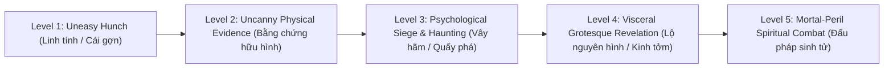
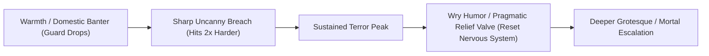

# Fear Engineering, Suspense Architecture & Folk-Horror Craft in *CHUYỆN MA CHÚ 3 DUY*

A practical scriptwriting analysis of how **CHUYỆN MA CHÚ 3 DUY** (`@chuyenmachu3duy`) constructs creeping, sticky Vietnamese folk horror across 532 unique Vietnamese transcripts (`5,524,851` words; 387.9 hours).

> [!NOTE]
> **Corpus Scope & Methodology**
> - **Quantitative baseline**: Deduplicated regex scan across all **532 unique `vi.txt`** transcripts indexed in [00-corpus-index.md](file:///c:/Users/ngoqu/OneDrive/Documents/Project/film-script/analysis/00-corpus-index.md).
> - **Qualitative close-reading (14 high-tension episodes across 6 subgenres)**:
>   - *Trùng Tang*: Tập 204 (*Bắt Lộn Hồn*), Tập 446 (*Trùng Tang Tế Xác*), Tập 486 (*Trùng Tang Huyết*)
>   - *Cô Dâu Tễ Xác*: Tập 500 (P1), Tập 502 (P3 *Đoạt Hồn*), Tập 504 (Phần cuối)
>   - *Bụi Đời Xóm Quỷ*: Tập 464 (P1 *Bà Ngoại Nuôi*), Tập 468 (Phần cuối *Ác Thú*)
>   - *Máu Hận Tình Thù*: Tập 433 (P1 *Nhà Hoang 3 Chủ*), Tập 437 (P5 *Ngải Rết*), Tập 441 (Phần cuối *Tử Nghiệp*)
>   - *Xóm Trọ Tà Linh Nhi*: Tập 455 (P1 *Uống Máu*), Tập 458 (P4 *Nhập Hồn Trấn Khẩu*)
>   - *Quỷ Ngãi Ma Lai*: Tập 613 (P8), Tập 618 (P13)
> - **ASR Normalization Notice**: Because `vi.txt` comes from YouTube auto-captions, phonetic Southern Vietnamese ASR typos appear verbatim in transcripts (e.g., `dong hồn` for *vong hồn*, `mã` for *mả*, `giải` for *vải*, `lữ`/`lửa` for *lưỡi*, `cổn` for *cố*, `XM` for *xâm/xăm*, `trắng hú` for *trắng hếu*, `Đụng má` for *Đụ má*). All quotes below preserve the verbatim transcript text with `[chuẩn âm: ...]` annotations where ASR errors occur; these are never treated as intentional authorial style.

### Corpus-Wide Fear & Suspense Signal Profile (`n = 532` unique `vi.txt`)

| Fear / Suspense Mechanism | Corpus Hits | Episodes Present | Coverage | Craft Role |
|---|---:|---:|---:|---|
| Simile anchors (`y chang như` / `y chang` / `giống như là`) | 6,222 | 521 / 532 | 97.9% | Grounds supernatural terror in familiar everyday objects |
| Question-stacking (`sao kỳ vậy` / `không lẽ` / `tại sao`) | 4,602 | 505 / 532 | 94.9% | Drives mystery deferral and listener lock-in |
| Uncanny hunch triggers (`thấy lạ` / `kỳ kỳ` / `ngộ lắm`) | 591 | 309 / 532 | 58.1% | Marks the first hairline crack in ordinary reality |
| Domestic warmth anchors (`đi nhậu` / `uống trà` / `nấu cơm` / `đi chợ`) | 677 | 275 / 532 | 51.7% | Builds grounded normalcy and relief valves |
| Paralysis / freeze cues (`cứng ngắc` / `cứng đơ` / `chết trân` / `đứng hình`) | 445 | 254 / 532 | 47.7% | Somatic terror response before or during haunting |
| Dread hypotheses (`rủi đâu` / `lỡ đâu` / `có khi nào`) | 486 | 249 / 532 | 46.8% | Plants worst-case mental projections in listeners |
| Spoken visceral reaction (`thấy gớm` / `thấy ghê`) | 480 | 197 / 532 | 37.0% | Replaces purple prose with earthy spoken revulsion |
| Possession / spirit rituals (`nhập xác` / `nhập hồn` / `triệu hồn` / `trục vong`) | 416 | 169 / 532 | 31.8% | Core set-piece engine for interrogation and conflict |
| Thermal / wetness cues (`lạnh tanh` / `lạnh ngắt` / `lạnh dờn` / `ướt nhẹp`) | 258 | 168 / 532 | 31.6% | Pre-visual sensory warning of yin/corpse presence |
| Somatic chill cues (`ớn lạnh` / `nổi da gà` / `nổi ốc cục` / `lạnh sống lưng`) | 196 | 139 / 532 | 26.1% | Internal body radar signaling unseen proximity |
| Auditory creeping (`bước chân` / `lẹp xẹp` / `lạo xạo` / `rột rẹt` / `cóc cóc`) | 265 | 139 / 532 | 26.1% | Builds spatial dread without showing the entity |
| Boundary breaches (`gõ cửa` / `kêu cửa` / `đập cửa`) | 292 | 135 / 532 | 25.4% | Threshold terror—inviting or blocking evil at the door |
| Counter-hex rituals (`trấn yểm` / `phá bùa` / `giải bùa` / `lập đàn` / `bắt ấn`) | 242 | 117 / 532 | 22.0% | Procedural spiritual combat |
| Folk horror critters (`con dòi` / `con rít` / `con rắn` / `con chuột`) | 1,078 | 113 / 532 | 21.2% | Tangible biological vectors of sorcery and rot |
| Grotesque dangling/swarming (`lòng thòng` / `lúc nhúc` / `lòi ra`) | 161 | 103 / 532 | 19.4% | Visceral visual markers of decay and violation |
| Olfactory cues (`mùi tanh` / `mùi thúi` / `thúi quắc` / `mùi khét` / `hôi rình`) | 146 | 89 / 532 | 16.7% | Triggers instant physical disgust before visual reveal |
| Exhumation set-pieces (`đào mả` / `bốc mộ` / `mở nắp hòm`) | 99 | 45 / 532 | 8.5% | Physical confrontation with buried proof of curses |
| Explicit premonition (`linh tính`) | 34 | 31 / 532 | 5.8% | Named sixth-sense inflection point |

---

## 1. The "Uncanny-in-the-Mundane" Trigger (Điểm gợn rùng mình giữa đời thường)

Chú Ba Duy almost **never** opens a scare with a monster lunging out of the dark. Instead, fear enters through a **hairline fracture inside deeply ordinary Vietnamese life**: a factory worker picking up a Shopee/Facebook package after overtime, a boy bored on a bicycle watching his father hoe a field at 2 AM, a pregnant wife complaining that her undershirt smells mildewy, or a dinner table of *cá kho quẹt* and boiled gourd.

The mechanism works in two beats:
1. **Hyper-normal baseline**: Establish mundane friction (poverty, overtime fatigue, rent costs, petty gossip, family arguments).
2. **The off-rhythm detail (`cái gợn`)**: Insert a single physical, behavioral, or social detail that is *95% explainable as ordinary*, yet *5% impossible*.

### Catalog of Recurring Anomaly Triggers

| Category | Concrete Anomaly Pattern | Verbatim Transcript Example |
|---|---|---|
| **1. Off-Rhythm Behavior of Familiar People (Hành vi lệch nhịp của người thân/láng giềng)** | Someone known to be warm, tidy, or energetic freezes mid-day, wears heat-inappropriate clothes, talks to empty air, or suddenly turns hostile. | `"ngồi thừ lừ ở đó cứng ngắt [chuẩn âm: cứng ngắc] cứng đơ luôn ngồi cứ nhìn vô hướng gốc [chuẩn âm: góc] tường vậy nè mà trong khi đây là ban ngày ban mặt nha... mặc nguyên cái áo chống nắng vậy nè nó dài thường thược [chuẩn âm: thườn thượt] luôn che mà ụp cái đầu lại... trời nực nội muốn chết ngồi mà trùm kính bít [chuẩn âm: kín bít] cái người chi vậy"` `[Máu Hận Tình Thù / Tập 437]` |
| **2. Suspicious Bargains & Half-True Neighborhood Warnings (Lời đồn nửa thực nửa hư / Giá rẻ bất thường)** | A room is suspiciously cheap (`có hai hào`), and a random passenger or neighbor turns pale upon hearing the landlord's name, offering a cryptic folk precaution without explaining why. | `"anh nói tới đây là cái mặt của bà già này biến sắc luôn cái bà mới hỏi ủa con Trinh hả mà sao nó dám cho bay mướn phòng cho mướn bao nhiêu... trời trời trời trời trời ơi nó dám cho mướn hả mà làm cái gì hồi đó giờ nó cho ai mà người ngoài mà vô đây mướn... bữa đầu tiên đó ha cúng kiến [chuẩn âm: cúng kiếng] đi xin phép người ta rủi đâu cái nhà có người khuất mặc khuất mày [chuẩn âm: khuất mặt khuất mày]"` `[Bụi Đời Xóm Quỷ / Tập 464]` |
| **3. Misplaced or Out-of-Place Ritual Objects (Vật lạ / Bùa lạ trong không gian đời thường)** | A black jar capped with red cloth on an ordinary home altar; a black salt-and-talisman pouch glued inside a cheap boarding room; an unexplained gold necklace with three jade pendants found around one's neck after waking up. | `"trên cái bàn thờ này anh Tám có thấy bả có để một cái hũ cái hũ nó đen đen như là cái khạp da bò nhỏ của mình vậy đó nghe rồi trên cái nắp hũ này có cột một cái miếng giải [chuẩn âm: vải] màu đỏ ụp lên đi ngang thôi là anh Tám cảm nhận liền giống như là có một cái gì đó mà nó cản mình lại mình giật ngược lại vậy nè"` `[Bụi Đời Xóm Quỷ / Tập 464]` |
| **4. Impossible Domestic Micro-Shifts (Đồ vật / cơ thể xê dịch trái tự nhiên)** | A spilled pot of half-cooked rice turns to muddy porridge instantly; a creeping vine pushed outside crawls back in at night; waking up rotated 180° with the fan unplugged and hair braided neatly in pigtails while the middle is matted rock-hard. | `"cơm ở trong cái nồi á nó đổ hết khoảng nửa nồi... mình nhìn y chang như là có ai mà đứng cái người ta lấy giò người ta đạp đạp nó nát hết trơn những cái hột cơm này nó nhuyễn nhừ như cháo luôn mà sình bùng không mà thấy ghê dữ lắm... trong khi nếu như ai mà có nấu cơm củi mọi người sẽ biết cái quá trình mình nấu cho tới khi mình chắc [chuẩn âm: chắt] nước cơm á lúc đó cái hột cơm nó chưa chín hoàn toàn... vậy tại sao cái này nó bị nát bấy hết trơn à kỳ quá"` `[Cô Dâu Tễ Xác / Tập 502]` |
| **5. Calendar & Posture Coincidences (Trùng ngày âm / Tư thế chết giống hệt nhau)** | Multiple relatives die on the exact same lunar day (`ngày 25 âm lịch` / `ngày 27 tháng 12`), or curl into the exact same unnatural posture—initially rationalized as mundane accidents or illness. | `"nhưng cái tư thế chết nó rất là kỳ nằm co cái người y chang một cái con tôm mà hai cái tay bịch [chuẩn âm: bịt] cái mặt lại vậy nè... vừa qua 49 ngày thôi... tới bà vợ chết bả chết bả nằm cái tư thế y chang như ổng mà cũng cái chỗ đó luôn... ở dưới hai cái lòng bàn chân của bả đó nó có hai cái dấu chấm đỏ vậy nè nghe"` `[Trùng Tang / Tập 486]` |
| **6. Biological & Olfactory Leakages (Mùi lạ / Máu / Côn trùng rò rỉ vào đồ sinh hoạt)** | Thick incense billowing through a boarding-room padlock hole at 10 PM; a smudge of fresh blood from a pinky finger on a white delivery slip; an unexplained smell of rotting toenail gunk or dead rat. | `"tôi đứng ở ngoài tôi hửi toàn là mùi khối [chuẩn âm: khói] nhang không à... cái lỗ mà mình sọt [chuẩn âm: thọt] cái tay vô mình lấy cái ổ khóa đó... khối [chuẩn âm: khói] từ trong nhà của nó đó nó bay ra bằng cái lỗ đó vậy đó bà... cái miếng giấy trắng nó có ghi cái tên của tôi á hình như là dính máu của nó... nó hơi ướt ướt máu một chút"` `[Xóm Trọ Tà Linh Nhi / Tập 455]` |
| **7. Subtle Sensory & Nature Omens (Gió trái chiều / Cây cỏ / Bói bài)** | Two opposing gusts of wind inside a closed room flipping only specific cards; dried kapok pods splitting open in moonlight resembling pale human heads; a dog barking persistently at its own master. | `"tự nhiên ở đâu anh gió nó thổi nó thổi từ ngoài cửa thổi vô làm cái hù vậy nè năm lá bài nó lật lên... rồi tự nhiên có một cái gió khác nữa nó thổi từ ngay cái chỗ tắm nè cái nhà vệ sinh á nó thổi ngược ra nó thổi một cái là bốn cái lá bài kia nó úp chỉ còn duy nhất một lá nó còn lại thôi... là cái lá ách bít"` `[Xóm Trọ Tà Linh Nhi / Tập 458]` |

**Key Scriptwriting Rule**: Never let the protagonist immediately yell *"Có ma!"* at Level 1. Notice how in `[Xóm Trọ Tà Linh Nhi / Tập 455]`, Chị Trinh hears cursing children at 10 PM and thinks *"con cái của ai mà giờ này không lùa vô nhà chơi... dòng cái thứ mà ba cái đứa báo hại báo đời"*. In `[Máu Hận Tình Thù / Tập 433]`, Mẫn hears footsteps on broken tiles and calls out his friends' names (`Còi ơi, Hải ơi, Nghĩa ơi`). The **rational mundane misreading** is what makes the eventual snap into supernatural terror land like a gut punch.

---

## 2. The 5-Level Fear Escalation Ladder

Across multi-part series and standalone episodes alike, Chú Ba Duy escalates dread along a disciplined **5-Level Ladder**. Jumping straight from Level 1 to Level 4–5 destroys immersion; skipping Level 2 leaves the threat feeling like hallucination (`ảo giác`).

### Breakdown of Each Level

#### Level 1 — Uneasy Hunch (`Linh tính` / Social & Spatial Wrongness)
- **What happens**: No proof yet. Just gossip, an off-kilter remark, a cold draft, a dream warning, or an unnatural silence. Characters actively rationalize it away.
- **Verbatim Anchor**: `"bữa nay sao em thấy hơi không ổn anh Tám ơi... ban đêm ban hôm nằm ngủ đây em sợ quá trời à em cảm giác giống như là ở đây có ma á anh kiểu sao sao á đêm nào ngủ cũng dợn dợn ốc hết trơn à ngủ không có được kỳ lắm kìa"` `[Bụi Đời Xóm Quỷ / Tập 464]`.
- **Another Anchor (Spatial/Social)**: `"em nhìn cái bàn thờ của nó càng trang hoàng cỡ nào là cái mặt của nó hả nó tái nhợt nó xuống sắc tới đó kiểu giống như là hai cái này tỷ lệ nghịch với nhau vậy đó bàn thờ càng đẹp thì nó càng xấu"` `[Xóm Trọ Tà Linh Nhi / Tập 455]`.

#### Level 2 — Uncanny Physical Evidence (Bằng chứng vượt khỏi giấc mơ)
- **What happens**: The "maybe I imagined it / maybe I dreamt it" excuse dies. Something leaves an undeniable **waking-world physical trace** on the body, room, or objects.
- **Verbatim Anchor (Waking Body Trace)**: `"hồi tối anh chỉ tưởng đâu là mình mới vừa trải qua một cái giấc mơ thôi vậy thì tại sao bây giờ á 10 cái ngón giò của ảnh nó cũng đau đớn nha... 10 ngón giò của anh á cái da á nó bị bong bong bong nó tróc ra vậy nè... vậy là hồi tối nó cắn cái giò mình là thiệt chứ đâu phải là mình nằm chiêm bao mộng mị"` `[Máu Hận Tình Thù / Tập 437]`.
- **Verbatim Anchor (Waking Room Trace)**: `"khi chị mở mắt ra... mình đã bị đảo cái đầu nằm lại rồi... cái quạt nó tắt hu [chuẩn âm: tắt hủ / tắt ngúm] rồi hình như là cái chui điện nó đã bị rút ra luôn rồi kìa... cái tóc của chị nó bị dính vô trong cái cầu thang... hai bên là thắt bính chính giữa là cái đầu tóc nó rối đanh vậy đây nè"` `[Xóm Trọ Tà Linh Nhi / Tập 455]`.
- **Verbatim Anchor (Living Plant Proof)**: `"nó mò làm sao mà nó bò tới xuống cái giò con nó quấn chặt vô cái giò con luôn... con bứt ra nó vẫn còn nằm trong phòng của con chứ nó là cây là cối mà vậy đó nó rút một cái tặt là nó rút ngược ra ngoài cái lỗ thông gió nó rút nghe mất tiêu luôn"` `[Xóm Trọ Tà Linh Nhi / Tập 458]`.

#### Level 3 — Psychological Siege / Haunting (Vây hãm tinh thần & Xâm phạm ranh giới)
- **What happens**: The entity actively **invades safe spaces** (the dinner table, the bedroom loft, the schoolroom, the family home), mocks or mimics loved ones, breaches protective wards, or puts the victim under relentless nocturnal siege.
- **Verbatim Anchor (Domestic Siege)**: `"Ổng mới vừa bới xong hai chén cơm bới qua cái chén thứ ba thôi thì ai cũng thấy cái ghế đẩu bằng cây ngồi ăn cơm á đang để trong góc á nó chạy cái rẹt qua tới cái bàn vậy đây nè... cái nồi cơm á nó quay cà vòng cà vòng nhẹ nhẹ nè... những cái hột cơm mà nó tơi tơi tơi đó bắt đầu nó đen y chang như mình đốt á nó cháy lan ra từ từ"` `[Cô Dâu Tễ Xác / Tập 502]`.
- **Verbatim Anchor (Boundary/Mimicry Siege)**: `"anh Út ơi có nhà không anh Út anh Út Hưởng ơi... cái tên Út Hưởng này á là cái tên cúng cơm cậu Út từ hồi mấy bữa trước khi mà mình lưu lạc xuống cái xóm này chưa ai biết tới... thấy ổng với bả với con Diễm nằm ngủ khì khì ở đó... kêu hoài không ai thức hết"` `[Cô Dâu Tễ Xác / Tập 502]`.

#### Level 4 — Visceral Grotesque Revelation (Lộ nguyên hình & Sự thật tàn khốc)
- **What happens**: The veil rips completely off. Listeners see the mutilated corpse, the parasites inside flesh, the true nature of the curse, or the horrific human crime buried beneath the haunting.
- **Verbatim Anchor (Buried Corpse Truth)**: `"dở cái nắp hòm ra thì mình thấy là cái mặt trong của cái nắp hòm phía trên á rất là nhiều những cái vết cào cào mà nó hằn lên nắp hòm vậy nè... hai cái mép miệng trên dưới dính chặt hết trơn cái cọng chỉ vẫn còn mà cái cọng chỉ bây giờ nó đen thùi lùi luôn... răng của cổ vẫn còn trắng hú [chuẩn âm: trắng hếu] mà đó hả đã mọc nanh hết trơn rồi nó dài thòn lòn vậy nè"` `[Trùng Tang / Tập 446]`.
- **Verbatim Anchor (Parasite Extraction)**: `"ảnh luồn cái mũi kim này qua bên một cái miếng da của ổng đó là cái da ngay tại cái thái dương này nè... cầm ảnh giật một cái bặt ra vậy đây nè... giữa cái sợi chỉ ngũ sắc á nguyên một cái con dòi... nó bò ngoe nguẩy gì nè mà hai cái đầu của nó bị XM [chuẩn âm: xăm/xỏ] bởi hai cái cây kim... nó đỏ như máu luôn vậy đó"` `[Trùng Tang / Tập 486]`.
- **Verbatim Anchor (Ma Lai Tableau)**: `"trên cái bàn đó khoảng ba cho tới bốn người đang ngồi chờm hởm hết trển... không có người nào có cái đầu hết... trên cái tủ thờ chừng một đống cái đầu của con người ta... nó quay ra nó nhìn"` `[Quỷ Ngãi Ma Lai / Tập 613]`.

#### Level 5 — Mortal-Peril Spiritual Combat (Đấu pháp sinh tử & Trả giá)
- **What happens**: Survival is no longer guaranteed. Physical violence, black-magic counters, failed wards, real blood loss, and collateral deaths collide in a chaotic finale where even the protagonist or exorcist bleeds, loses, or barely escapes.
- **Verbatim Anchor (Chaotic Ambush + Mortal Injury)**: `"bả lấy cây dao á bả XM [chuẩn âm: xăm/đâm] vô cái bụng làm một cái ọt vậy nè ngay tại cái bụng luôn còn dính khắn cây dao trong này... máu nó chảy lênh láng vậy nè... bắt đầu là con quỷ nó ngồi chòm hổm nó liếm nó liếm vậy đây nè y chang chó mà uống nước vậy đó"` `[Bụi Đời Xóm Quỷ / Tập 468]`.
- **Verbatim Anchor (Failed Spell + Lightning Climax)**: `"bốn cái cây sậy nó khô nó giòn quá nó gãy làm cái rớp vậy nè... cái xác của ổng bây giờ cái đầu nó lặt lìa lặt lội vậy nè mà ổng rất là mạnh... ông trời ổng nhá ổng xẹt một cái... bị văng cả tới khoảng hơn cả chục thước... xác của ổng thì khỏi nói rồi cháy đen thùi lùi... bể cái bụng của ổng ra... anh Hai Hơn cũng chết luôn đen thùi lùi chết quéo mà mở đứng tròng con mắt"` `[Cô Dâu Tễ Xác / Tập 504]`.

### Ladder Mapping Across 4 Representative Arcs

| Arc | L1: Hunch | L2: Physical Evidence | L3: Siege / Haunting | L4: Grotesque Reveal | L5: Mortal Combat |
|---|---|---|---|---|---|
| **Trùng Tang Huyết** *(Tập 486)* | Brother dies curled like a shrimp after drinking | Wife dies 49 days later in identical pose with 2 red dots under soles | Dead brother knocks nightly; 4 deaths on lunar 27th; family faces turn ash-black | Winged red maggots bursting foul blood from corpses; live red worm stitched out of uncle's temple | Midnight bell-exorcism making family vomit worms; noon exhumation where winged maggot lunges at mouth |
| **Cô Dâu Tễ Xác** *(Tập 500–504)* | Girl claims headless man watches kitchen; older brother scoffs | Half-cooked rice turns to muddy mash; roof tile slices ward string | Stool slides to dinner table; rice chars black; fake wife mimics voice & locks spine | Live bride buried tied to headless corpse every 10 years; self-sawn neck dangling | Failed stealth charm; snapping reeds; 3-way blade grapple ended by lightning strike killing 2 men |
| **Xóm Trọ Tà Linh Nhi** *(Tập 455, 458)* | Neighbor's altar gets grander as his face turns gaunt and dark | Blood smudge on parcel slip; body flipped 180°, hair braided & tied with vine | Headless kids knock at naptime; slurping in kitchen; living vines grab ankle | 10 fingertips punctured with needle holes; possessed son's scalp peels clean & chest splits in cross | Parents pin son, bleed palms into talisman paper, trap spirit under bell while mother's fingers are chewed to bone |
| **Bụi Đời Xóm Quỷ** *(Tập 464, 468)* | Cheap room (`2 hào`); old woman reacts sharply to landlord's name | Black jar with red cloth repels Tám with demonic stench | Hanging ghost in red dress grinning from loft; Bà Dung isolates Tám at home | Demon rises from poured jar water with road-crushed split face dropping maggots; headless nude corpse | Bà Dung tries to carve Tám's eyes out, stabs his belly; father summons `âm binh` rescue |

---

## 3. Sensory & Visceral Folk Horror Toolkit

### A. Sight & Grotesque: The "Kitchen-to-Morgue" Simile Engine

Chú Ba Duy almost **never** uses clinical medical terminology (*hoại tử*, *xuất huyết nội*, *tử thi phân hủy độ 3*) or literary gothic purple prose (*một nỗi kinh hoàng vô định bao trùm màn đêm*). Instead, **97.9% of episodes** (`6,222` hits) rely on **earthy, tactile Mekong Delta everyday similes** (`y chang như...`, `giống như là...`) paired with blunt spoken revulsion (`thấy gớm muốn chết luôn vậy đó`, `thấy ghê dữ lắm`).

Why does this work so devastatingly well? Because the listener's brain already has a strong **muscle-memory sensory file** for soaking paper, cleaning fish, plucking scalded chicken, or smelling toenail gunk. Hijacking that everyday sensory file triggers immediate visceral nausea.

| Grotesque Subject | Everyday Folk Simile Used by Chú Ba Duy | Verbatim Quote |
|---|---|---|
| **Waterlogged / Rotting Face** | Soaked paper disintegrating in water | `"cái da mặt đồ răng cỏ đồ của ổng là bây giờ á nó bị ngâm nước á nó bị ngâm nước cái nó chèm nhẹp ra y như một cái tờ giấy mà ngâm nước y chang như vậy... thịt thà của ổng nó càng chảy ra, nó đứt từng miếng từng miếng giống như là cái miếng giấy nó ướt rồi nó rớt xuống đất vậy đó"` `[Quỷ Ngãi Ma Lai / Tập 613]` |
| **Sudden Hair Shedding during Possession** | Plucking a chicken dunked in boiling water | `"nó đi hết trơn tóc luôn mọi người... y chang con gà nhúng nước sôi mà mình vột [chuẩn âm: vặt] lông... nó tuột nguyên một mảng ngay chính giữa đầu... lộ ra nguyên một cái da đầu vậy nghe trắng hú [chuẩn âm: trắng hếu]"` `[Xóm Trọ Tà Linh Nhi / Tập 458]` |
| **Bursting Cursed Belly** | Squeezing a pregnant fish's belly | `"vừa nằm cái ạch một cái thôi là nguyên cái bụng giống như là cái con cá mà nó có bầu á, nó chuẩn bị đẻ con rồi đó, mình nặn cái bụng của nó ra đó, nó làm một cái ọt một cái là nguyên một thao [chuẩn âm: thau] nước nó trào ra... toàn là những cái chất bầy nhầy bầy nhầy giống như máu bầm"` `[Máu Hận Tình Thù / Tập 441]` |
| **Mummified Corpse Re-Plumping in Fire** | Dried vegetables soaking back to plumpness in water | `"sau khi mà cái da thịt này nó bén lửa rồi đó thì trước mắt mọi người ai cũng thấy da dẻ của cổ [ASR: con này] từ từ á nó hồng hào nó phì phì phì ra trở lại kiểu giống như là một cái cọng rau mà phơi khô mình ngâm nước cái nó tươi trở lại vậy đó"` `[Trùng Tang / Tập 446]` |
| **Grotesque Pulsing Organic Cavity** | Clams/oysters opening and closing in chili water | `"nó mở từ từ vậy nè mở ra cái nó khép lại mở ra nó khép lại giống như mà mình mua những cái con hào những cái con sò lông sò huyết mình ngâm ớt á"` `[Máu Hận Tình Thù / Tập 433]` |
| **Stitched Corpse Mouth** | Sewing shut a burlap rice sack | `"đầu tiên á là ông cố mới cắt cái sợi dây rồi rút ra y chang như cọng dây mà may cái bao gạo lại vậy đó"` `[Trùng Tang / Tập 446]` |
| **Mangled Human Fingers** | Saw-toothed ragged strips showing white tendon/bone | `"bốn ngón tay của bả vậy nè nó bấy nhầy hết trơn luôn nó cà cưa cà cưa cà cưa nè nó răng cưa răng cưa ha nó bấy bá mức độ mà da của bả đó nó lòng thòng lòng thòng ra rồi mình thấy luôn cái xương cái gân vậy á nó trắng hú [chuẩn âm: trắng hếu]"` `[Xóm Trọ Tà Linh Nhi / Tập 458]` |
| **Crushing a Tiny Ghost Child** | Elephant foot squashing a gecko | `"vô tình chị đạp chị dậm lên cái người của nó luôn trời ơi mọi người hình dung giống như là cái giò con voi mà nó đạp lòi ruột con thằn lằn vậy đó... nó hơi trơn trơn nó hơi nhớt nhớt giống như là một cái bãi bầy nhầy"` `[Xóm Trọ Tà Linh Nhi / Tập 455]` |

**Spoken Texture Vocabulary Bank** (high-frequency tactile/visual modifiers):
- Wet/rotting textures: `bầy nhầy`, `chèm nhẹp`, `sệt sệt`, `nhớt như rong` (`như đổ rau câu`), `ướt nhẹp`, `rịn ra`, `phập phình phập phình`.
- Hanging/protruding shapes: `lòng thòng`, `thòn lòn`, `lúc nhúc`, `lồi ra`, `lặt lìa lặt lội`, `bấy nhầy`, `tét ra làm hai`, `trắng hếu`, `tím rịm`.
- Blunt reaction tags: `thấy gớm muốn chết luôn vậy đó`, `thấy ghê dữ lắm`, `ớn muốn chết`, `nhìn hết hình dung luôn`.

### B. Sound, Smell, Temperature & Somatic Cues

#### 1. Smell (Khứu giác — The Pre-Visual Disgust Weapon)
Chú Ba Duy uses hyper-specific foul smells to make the listener wrinkle their nose *before* the character sees the source:
- **Rotting toenail gunk**: `"hửi thấy một cái mùi cái mùi này nó hơi thủm thủm nó hơi thúi thúi... mọi người biết mỗi lần mà đi làm móng á cái lấy cái đồ móc đó móc hai bên khóe ra nó đen sù lù [ASR: đen sự lừ] vậy nè mình đưa lên mũi mình hửi là nó thúi quắc thúi ình [ASR: thú quắc thú annh] luôn cái mùi này y chang như vậy"` `[Máu Hận Tình Thù / Tập 437]`.
- **Infected menstrual blood (squashed corpse-maggot)**: `"nó chỉ xịt ra một cái nước gì đó mà nó sệt sệt nó đỏ đỏ y chang như máu vậy đó mày... cái mùi này nó y chang như cái mùi mà máu kinh của đàn bà mấy cái bữa mà bị viêm nhiễm [ASR: Diêm nhiễm] vậy đó"` `[Trùng Tang / Tập 486]`.
- **Dead rat / burnt plastic / raw fish blood**: `"mùi thúi nha cái mùi y chang như chuột chết vậy đó"` `[Trùng Tang / Tập 486]`; `"mùi khét [ASR: bùi khác] giống như là cái nhà này đốt giấy hay là đốt ba cái bọc nilon vậy á mà hồi nãy giờ có đốt cái gì đâu"` `[Trùng Tang / Tập 486]`; `"nó tanh... y chang như mùi mà máu của ba cái con cá rồi nọ nó tanh kiểu vậy á"` `[Xóm Trọ Tà Linh Nhi / Tập 455]`.
- **Sweet uncanny scent as karmic release**: `"vẫn còn để lại một cái mùi rất là thơm cái mùi nó thơm mà nó ngăn ngát ngăn ngát"` `[Trùng Tang / Tập 446]`.

#### 2. Sound & Onomatopoeia (Âm thanh & Từ tượng thanh rùng rợn)
Instead of generic "eerie music" or "scary scream," Chú Ba Duy builds dread with **rhythmic, repetitive, close-range domestic sounds**:
- **Footsteps on specific surfaces**:
  - Broken tiles in rain: `"nghe cái tiếng người ta đi lẹp xẹp lẹp xẹp lạo xạo vậy đó... có cái dấu chân của người bước lên tới đâu là nó bể làm rớp rớp rớp tới đó"` `[Máu Hận Tình Thù / Tập 433]`.
  - Heavy barefoot stalking: `"nghe một cái tiếng bước chân nó làm cà thịt phịt thịt phịt thịt [chuẩn âm: kịch phịch / lệt phệt] vậy nè giống như ai mà đi giò không đi chân đất á mà cố tình đi thiệt là mạnh cho dượng Tám ổng nghe"` `[Bụi Đời Xóm Quỷ / Tập 464]`.
  - Multiple shadows dragging one sleepwalker: `"tiếng bước chân cái tiếng này lịch phịch lịch phịch giống như hai ba người đi vậy đó"` `[Máu Hận Tình Thù / Tập 437]`.
- **Ordinary eating/bodily sounds in an empty room**:
  - Slurping in the dark kitchen: `"y chang như có ai mà đang ngồi mà húp một cái tô mì hay là cái gì mẹ ơi ngồi húp [ASR: hút] rột rột luôn mẹ"` `[Xóm Trọ Tà Linh Nhi / Tập 458]`.
  - Severed windpipe rasping: `"cái đầu của nó cũng nó ngã ra mà nó cứ khẹt khẹt khẹt [ASR: cặt khẹt CT khẹt] vậy nè... thanh quản rồi là bị đứt hết chỉ có la khẹt khẹt"` `[Cô Dâu Tễ Xác / Tập 502]`.
  - Water jar bubbling: `"nước ở trong cái lu á nó làm ục ục ục nó làm y chang như mình lặn ngập dưới sông mà mình thổi bong bóng nước lên vậy đó"` `[Cô Dâu Tễ Xác / Tập 502]`.
  - Demon grinding teeth: `"nghe bả nghiến răng trèo trẹo vậy nè bả nghiến kẹo kẹo kẹo"` `[Quỷ Ngãi Ma Lai / Tập 618]`.
- **Animal Alarm Cues (`chó sủa`, `chim bay đen trời`, `gà gáy`)**:
  - Dog barking *at its own owner* before its neck snaps invisibly: `"con chó trong nhà của tôi nó sủa quá sủa luôn... nó nhìn tôi nó sủa trong khi tôi là chủ mà sao nó sủa tôi... chỉ cần cổ mở con mắt một cái là con chó tôi nó cụp cái đuôi lại... cái đầu con chó nó vặn [ASR: dặn] ngược lên vậy nè là con chó tôi chết queo trước mắt của tôi luôn"` `[Trùng Tang / Tập 446]`.
  - Flock of birds blackening the sky when a cursed coffin opens: `"vừa động tới cái xác rồi đó hả là chim ở đâu không biết nó bay tùm lum trên trời vậy nè nó bay đen kịt [ASR: đen kịnh] nguyên cả bầu trời"` `[Trùng Tang / Tập 446]`.

#### 3. Temperature & Thermal Contrast (Nhiệt độ tương phản)
Chú Ba Duy's sharpest thermal technique is **impossible thermal contrast**—cold inside heat, or hot inside freezing rain:
- **Warm rotting fluid in freezing rain**: `"nó chảy cái nước nó ướt nhẹp cái bàn tay của anh vậy nè cái nước nó rất là ấm nó ấm hỉnh nha nghe trong khi ngoài trời là mưa rất là lạnh anh lạnh cóng [ASR: lạnh cống] cái người vậy nè"` `[Máu Hận Tình Thù / Tập 433]`.
- **Scalding ghost tongue**: `"chụp phải một cái gì đó nó dài dài mà nó mềm mềm vậy nè... mà nó nóng như là than vậy đó... đụng vô đụng không có nổi"` `[Máu Hận Tình Thù / Tập 433]`.
- **Draft behind the nape in a hot room**: `"ở phía sau ót của mình á nó lạnh nó lạnh y chang như là những cái buổi sáng sớm của cái mùa mà gần Tết á nó thổi cà hù hù hù vô vậy nè"` `[Bụi Đời Xóm Quỷ / Tập 464]`.
- **AC-cold room with only an electric fan**: `"thời điểm đó thì đâu có máy lạnh gì toàn là xài quạt không à nghe nhưng mà chị cảm nhận cái phòng đó rất là lạnh luôn"` `[Máu Hận Tình Thù / Tập 437]`.
- **Internal scalding during exorcism**: `"trong người của mình á giống như có ai thiêu ai đốt mà nó rát nó rát hơn cái cảm giác mình phỏng nước sôi rất là nhiều"` `[Cô Dâu Tễ Xác / Tập 502]`.

#### 4. Somatic & Possession Cues (Phản ứng cơ thể & Nhập xác)
- **Body-radar goosebumps**: `"đứng mà nó run vậy nè nó bị lạnh á nó nổi ốc cục hết trơn luôn nó nói chú Út ơi mỗi lần mà con nổi ốc cục á là chỗ đó có ma đó chú Út"` `[Cô Dâu Tễ Xác / Tập 502]`.
- **Electric shock + telepathic baby scream on touch**: `"vừa đụng cái tay vô vậy nè thì anh cảm giác nha giống như là anh mới vừa chọt cái tay của anh vô ổ điện đó nó tê tê vậy đó nó tê mà nó lạnh... anh nghe trong đầu của anh á có cái tiếng y chang như là con nít mà nó mới vừa lọt lòng á"` `[Xóm Trọ Tà Linh Nhi / Tập 458]`.
- **Tiptoe gait of the possessed**: `"chỉ đi bằng cái mũi giò thôi nhón cái gót cao lên vậy đây nè bởi vậy tới bây giờ chị mới tin người ta đồn á là khi mà một cái người mà bị quỷ [ASR: hủy] nhập á người ta chỉ đi nhón cái gót thôi là có thiệt"` `[Quỷ Ngãi Ma Lai / Tập 613]`.
- **Boneless heavy weight + melting face**: `"cái người của nó đó nó mềm xèo y chang như cái con rắn mà không có xương vậy đó nó mềm nhũng ra mà nó ưỡn ẹo ưỡn ẹo vậy nè mà nó nặng trịch... cái mặt của nó đó nó chảy xuống vậy nè nghe y chang như một cái bà già... nó chảy nó xệ xuống"` `[Cô Dâu Tễ Xác / Tập 502]`.
- **Voice/register rupture**: Sudden switch from respectful to insolent (`nói chuyện trống lóc`, `[Cô Dâu Tễ Xác / Tập 500]`), whispering Khmer incantations out of a Kinh woman's mouth (`[Cô Dâu Tễ Xác / Tập 502]`), or staring without blinking while a red membrane pulls over the eyeball (`kéo nguyên một cái màn màu đỏ... bít chịt con mắt hết`, `[Xóm Trọ Tà Linh Nhi / Tập 458]`).

---

## 4. Ritual & Spiritual Confrontation Choreography

Why don't Chú Ba Duy's 20–40 minute ritual sequences feel boring or repetitive? Because he treats every ritual like a **high-stakes physical heist / surgical procedure** with strict tools, narrow time windows, fragile human bodies, and sudden complications—never a magical "wave hand, cast spell, problem solved" montage.

### Anatomy of the 4 Signature Set-Pieces

#### Set-Piece A: Exhumation & Coffin Opening (`Đào mả / Khai quan`)
1. **Locating the grave via hybrid tracking**: Compass/bát quái needle leads only partway (`nhiệm vụ của tao chỉ tới đây thôi`); the karmically linked human must kneel and pray until an animal omen (sparrow landing on the hand and circling a bush) pinpoints the exact spot `[Trùng Tang / Tập 446]`.
2. **Permission & timing lock**: Must ask living family (`xin phép`) and hit exact solar window (`đúng cái giờ Chánh Ngọ`, `[Trùng Tang / Tập 486]`), plus silence warning for onlookers (`đừng có ai nói ra nói vô gì hết nha`).
3. **Coffin announcement & anomaly check**: Knock three times on coffin lid (`gõ vô cái hòm ba cái`) before prying; discover abnormal sealing (`đếm chẵn 108 cây đinh`, `[Trùng Tang / Tập 446]`).
4. **Grotesque inspection inside the coffin**: Scratch marks on inner lid + worn fingertips + sewn lips (`[Trùng Tang / Tập 446]`), hair-cord threaded through skull eye sockets (`[Máu Hận Tình Thù / Tập 441]`), or un-decomposed body tied at the waist to headless victims (`[Cô Dâu Tễ Xác / Tập 504]`).
5. **Action & Sudden Hazard**: Reaching fingers bound in five-color thread into eye sockets to flush out a winged blood-maggot -> an onlooker breaks silence and yells -> maggot launches straight at his open mouth, caught inches from his lips `[Trùng Tang / Tập 486]`.
6. **Multi-stage sealing/cremation**: Unstitch lips, remove mouth talisman, burn body until smoke funnels straight up (`[Trùng Tang / Tập 446]`), OR sew a specific herbal pouch (`thần sa, chu sa, hùng hoàng, địa liền, đại hồi, quế chi`), wrap coffin 7 times in five-color thread, nail 4 corners with talismans, chant `Tứ Tung Ngũ Hoành`, and mandate a **stranger** deliver the spirit tablet to a pagoda for 3 years `[Trùng Tang / Tập 486]`.

#### Set-Piece B: Possession Interrogation & Spirit Trapping (`Triệu hồn / Nhập xác hỏi cung / Trấn khẩu`)
Best exemplified in `[Xóm Trọ Tà Linh Nhi / Tập 458]`:
1. **Diagnostic failure**: Offer water -> pours right back out (`trào ngược ra`); call victim's name -> unblinking glare (`lườm`).
2. **Physical pressure to force speech (`khai khẩu`)**: Husband clamps temples, wife presses both thumbs hard into the Adam's apple (`chấn vô ngay cái yết hầu`). Still silent!
3. **Counter-move #1 (Swallowed Talisman)**: Father writes a sigil on a school notebook page, wads it up, shoves it down the throat -> victim vomits thick mud and phlegm. **Plot twist**: They unfold the paper—**a clean hole is eaten right through the middle where the sigil was written** (`nó nuốt rồi... nuốt cái chữ bùa`).
4. **Escalation**: Bystanders try to pin him and get shocked off like touching live electricity; victim claws mother's forearms bloody despite short nails.
5. **Counter-move #2 (Blood-Drain Timer)**: Father stabs needles into both palms -> thick black blood oozes -> stuffs two folded talisman balls into palms to absorb blood -> **ticking clock**: `"tờ bùa này tôi viết á nó chỉ rút máu trong khoảng thời gian ngắn thôi... đợi tới chừng nào mà cái tờ giấy này không còn khả năng hút được cái máu nhiều hơn nữa là lúc đó bà không có hỏi được đó hỏi lẹ đi"`.
6. **Grotesque counter-reaction & Capture**: Eyeballs veil red, scalp slips off in one sheet, chest inflates and splits in a cross -> parents finally herd the entity into a bronze bell fitted onto a grooved wooden board (`y chang như là mình đang cố gắng mình bắt con gà mình lùa nó vô trong cái bội gà vậy đó`), leaving mother's four fingers chewed to white bone—and they STILL cannot kill it until **6:00 AM** (`giờ Dương thịnh Âm suy`)!

#### Set-Piece C: Warding, Counter-Hexing & Purification (`Trấn yểm / Phá bùa / Tẩy uế`)
- **Improvised Household Ward (`[Cô Dâu Tễ Xác / Tập 502]`)**: Uses fishing line threaded through soot-blackened bamboo pot-stands (`ghế nhắc nồi`), smeared with cremation-ash boat caulk (`keo chai trộn tro lò thiêu`), plus burnt talisman ash sprinkled at dog-holes (`lỗ chó`), family members lying horizontally across doorways holding garlic cloves in their mouths and talismans on their chests, and a 9-tier miniature funeral pyre built from kitchen chopsticks!
- **Two-Stage House Exorcism (`[Trùng Tang / Tập 486]`)**:
  - *Stage 1 (12:00 AM — inverted yin/yang logic!)*: Because blood-worm sorcery feeds on yang (`kỵ âm thụ dương`), Thầy Sáu must strike at midnight when yin peaks. Family chants *Thanh Tâm Chú* 7 times; on the 7th repetition, Thầy Sáu strikes the coin-sword against the bronze bell (`một cái boong`) -> acoustic shock triggers mass vomiting of red worms -> skewered onto silver needle into *hồ lô bát quái*.
  - *Stage 2 (Dawn — `Khưu Tà Tản Âm Trận`)*: Family forms a human circle holding white candles at chest height; Thầy Sáu paints a yin-yang symbol using dew-mixed black/white inks consecrated 108 days, plants 49 incense sticks inside/outside, chants until sunrise -> gray plastic-like smoke pours from every family member's seven orifices (`Thất khiếu`) and merges with reversed incense smoke exiting the back door.

#### Set-Piece D: Sorcerer/Demon Duel (`Đấu pháp với thầy tà / quỷ dữ`)
Look at the **3-faction standoff** in `[Quỷ Ngãi Ma Lai / Tập 618]`:
- Every combatant holds **hostage leverage** over another, forming a closed pain-loop (`nó là một cái hình tròn với nhau vậy đây nè`):
  - Thầy Tâm holds `bà cọp`'s cub hostage inside Thím Ba's belly.
  - `Bà quỷ già` secretly swapped Thầy Tâm's command cloth earlier, stealing control of his `âm binh`, and threatens to rip their entrails out if they don't stab upward through the altar into Thầy Tâm's groin/ritual object.
  - Anh Nghĩa's mortal body is protected by `điển ông nược` (sacred river dolphin spirit), preventing Thầy Tâm from killing him directly without triggering backlash.
- Result: Combat is a **battle of hidden prep, betrayal, rules, and pain thresholds**, not glowing anime lasers.

### The 5 Anti-Monotony Engines (How Long Rituals Stay Riveting)

1. **Imperfect / Handicapped Exorcist**: Chú Ba Duy explicitly states his rule in `[Cô Dâu Tễ Xác / Tập 504]`:
   > `"nếu như chuyện nào cũng gặp mấy cái ông thầy hay đụng là xử đụng là xử thì nó đâu có gây cấn bằng những cái chuyện mà gặp những cái ông thầy chưa có cao đạo như ông thầy Út này đâu đúng không mọi người"`
   Cậu Út loses his real toolkit in the river, misapplies a locking mudra (`khóa vong`) instead of an expulsion mudra, and constantly has to improvise with chopsticks and pot-stands.
2. **Failed First Attempts (`trật vuột lên xuống`)**:
   - Cậu Út's hiding spell fails instantly and his four dried reeds snap (`gãy làm cái rớp`) `[Cô Dâu Tễ Xác / Tập 504]`.
   - Chị Tâm tries ten times to snip the skull-cord with razor-sharp scissors and the cord refuses to cut `[Máu Hận Tình Thù / Tập 441]`.
   - The talisman shoved down Khiêm's throat gets its sigil eaten clean out of the paper `[Xóm Trọ Tà Linh Nhi / Tập 458]`.
3. **Hidden Counters & Sabotage**:
   - Ông Sáu Lư secretly left **1 of 21 needles** embedded in the daughter-in-law's spine during an earlier "helpful" exorcism so he could summon her later `[Cô Dâu Tễ Xác / Tập 504]`.
   - The mother unknowingly destroyed the landlord's protective salt-pouch (`bùa kỵ bùa`), accidentally leaving the room vulnerable `[Xóm Trọ Tà Linh Nhi / Tập 458]`.
   - The roof tile falls and slices the ward line the exact second Anh Tư swears at the ghost `[Cô Dâu Tễ Xác / Tập 502]`.
4. **Hard Temporal & Rule Clocks**:
   - Can only trap until 6:00 AM (`từ đây cho tới trước 6 giờ sáng`) `[Xóm Trọ Tà Linh Nhi / Tập 458]`.
   - Blood-soaking talisman only buys seconds of interrogation `[Xóm Trọ Tà Linh Nhi / Tập 458]`.
   - Inverted yin/yang timing (`12 giờ đêm` vs `giờ Chánh Ngọ`) `[Trùng Tang / Tập 486]`.
   - Breaking one taboo (taking off the mildewy protective undershirt for *one night*) collapses the entire protection `[Xóm Trọ Tà Linh Nhi / Tập 458]`.
5. **Irreversible Physical or Karmic Cost**:
   - Mother's hand chewed to bone `[Xóm Trọ Tà Linh Nhi / Tập 458]`; Chị Tâm's belly ruptures because cutting Mẫn's bond triggers karmic backlash (`bứt dây động rừng`) `[Máu Hận Tình Thù / Tập 441]`; Anh Hai Hơn dies by lightning because he swore a reckless false oath `[Cô Dâu Tễ Xác / Tập 504]`.

---

## 5. Suspense Deferral & Question-Stacking

Quantitative proof: Question-stacking triggers (`sao kỳ vậy`, `không lẽ`, `tại sao`) appear **4,602 times across 505 / 532 episodes (94.9%)**, and dread-projection hypotheses (`rủi đâu`, `lỡ đâu`, `có khi nào`) appear **486 times across 249 / 532 episodes (46.8%)**.

Chú Ba Duy rarely solves a mystery in the scene where it appears. Instead, he operates a **Question-Stacking Engine**: every time he answers 1 question, he opens 2 more—keeping the listener's brain in an unresolved loop (`Zeigarnik effect`).

### The 4 Deferral & Question-Stacking Patterns

#### 1. Rapid-Fire Internal Question Cascades (Xếp chồng câu hỏi ngay tại điểm gợn)
Right after a creepy beat, the narrator voices the listener's exact confusion in 3–5 stacked questions without answering them:
> `"Ủa hồi nãy lúc mà mình mới vừa bước ra từ cái phòng mình á tại sao mà mình không thấy tụi nó? Bây giờ mình đứng ngay tại phòng thằng Lễ thì tụi nó đã đứng ngay trước cửa phòng mình? Ủa vậy tụi này là ai ta? Mà hai ba cái phòng gần phòng chị là không có nhà ai có con cái nhiều vậy hết trơn á, ở đâu ra vậy?"` `[Xóm Trọ Tà Linh Nhi / Tập 455]`

> `"Ủa không lẽ cái cô gái mà xuất hiện ở trong mơ của mình cổ mặc cái bộ đồ màu đỏ với lại cái người mà đã hại cái thằng đó đó là một người hay là sao? Mà quan trọng là cổ nói mình đã giúp đỡ cổ cả cuộc đời này cổ nợ mình một cái ân tình. Ủa mình giúp đỡ cho ai? Mình nghèo chết mẹ luôn mình có giúp đỡ được cho ai đâu mà tại sao mà cái cô này cổ nói là đời này kiếp này cổ nhớ ơn mình chứ?"` `[Trùng Tang / Tập 446]`

#### 2. Deliberate Information Withholding & Deferred Payoff (Treo lời giải / Hứa hẹn có hẹn giờ)
Chú Ba Duy openly signals that a bizarre detail has a dark reason, then refuses to reveal it until the emotional peak:
- `"nhưng nó không cho bà Tâm này chết là đều có lý do của nó hết. Lý do làm sao thì một hồi sau Duy sẽ nói."` `[Máu Hận Tình Thù / Tập 441]`
- `"Lúc mà túi đồ mất chỉ có trời biết đất biết với lại một người khác biết, mà người đó là ai á thì trong những phần chuyện tiếp theo mọi người sẽ được biết."` `[Cô Dâu Tễ Xác / Tập 502]`
- `"người ta đã cắt cái đầu rồi mà tại sao người ta lại đội nón lá... cái chi tiết ở hiện tại đó chính là hiện tại của dì Nghiệp... Vậy thì bây giờ mọi người nghĩ đi, cái con cọp mà ông thầy Tâm ở trong quá khứ ổng nuôi á, với cái con cọp mà ở nhà của chú Sang... thì có cái mối liên hệ gì với nhau? Tại sao mà cái ông Út đó ổng vẫn giữ những cái chân, những cái giò, những cái móng của con cọp...?"` `[Quỷ Ngãi Ma Lai / Tập 618]`

#### 3. Dual-Hypothesis Branching (`Một là... Hai là...`)
Instead of telling the audience the answer, the protagonist/exorcist lays out two terrifying possibilities so the listener actively debates both while the next scene unfolds:
> `"Vậy nó sẽ có hai khả năng: một là cái vong hồn của người nữ này nằm ở trong cái khăn có dính máu đó mình đang giữ; còn hai nữa là nó đã thoát xác rồi nhưng nó vẫn còn bị vướng bị giam giữ bên nhà bển."` `[Cô Dâu Tễ Xác / Tập 502]`

#### 4. The "Confession-Delayed-by-Horror" Loop & Multi-POV Handoffs
- In `[Máu Hận Tình Thù / Tập 437]`, Mẫn begs Chị Tâm to reveal her secret (`kể cho anh nghe đi`). She freezes -> tries to leave -> collapses with a swelling belly -> only *after* wearing his necklace does she start confessing, and her confession itself starts with a shock hook (`"tôi có chồng mà tôi có hai đời chồng luôn nữa"`) that takes *multiple episodes* to reach the origin of the curse!
- In `[Xóm Trọ Tà Linh Nhi / Tập 455]`, Narrator #1 moves away after Lễ's suicide and hears only rumors -> Chú Ba Duy immediately pivots to Narrator #2 (Anh Trọng, room #1) who was standing in the same hallway -> who then listens to Narrator #3 (Chị Trinh, fresh out of the shower), stacking eyewitness layers while keeping the core cause hidden.

---

## 6. The Warmth / Humor Relief Valve (Van xả áp lực)

Nonstop grimdark terror numbs the nervous system within 10 minutes. Chú Ba Duy keeps listeners glued for **1 to 5 hours** by oscillating between dread and **ordinary Vietnamese warmth, earthy humor, and domestic pragmatism**. Domestic grounding cues (`đi nhậu`, `uống trà`, `nấu cơm`, `đi chợ`) appear in **51.7% of episodes** (`677` hits).

### The 4 Types of Relief Valves in the Corpus

#### 1. Domestic Banter & Macho Swearing Right Before a Breach (The Guard-Drop Setup)
In `[Cô Dâu Tễ Xác / Tập 502]`, immediately after a terrifying afternoon with a headless ghost, Chị Tư returns from market, cooks *cá kho quẹt* and boiled gourd, and Anh Tư struts in swearing like an unbothered Mekong farmer:
> `"Đụng má [chuẩn âm: Đụ má] đứa nào mà vô nhát nhà tao hả vô quậy quạn [chuẩn âm: quậy quá / quấy phá] nhà tao chết mẹ tao à... nhiều khi mà đi cầu á nó ngồi trên đọt dừa nó chổ [chuẩn âm: chọi] xuống tủm tủm tủm tủm vậy đó nè"` `[Cô Dâu Tễ Xác / Tập 502]`
The listener laughs at the image of ghosts tossing stuff into the outhouse pond—and **in the very next sentence**, roof tiles smash down and slice Cậu Út's ward string clean in half!

#### 2. Wry Pragmatism Mid-Haunting (Treating Ghosts Like Rude Guests)
Even *during* an active haunting, Chú Ba Duy injects grounded working-class exasperation so characters feel painfully real:
> `"Ê ăn thì tôi để cho ăn đàng hoàng chứ nhà người ta bỏ công bỏ sức ra nấu cơm hồi nãy giờ chưa có được ăn uống gì hết đi mần về mệt chết mẹ à còn ngồi đó chầu chực đợi mấy người ăn xong nữa hay là sao"` `[Cô Dâu Tễ Xác / Tập 502]`
And right after smacking the possessed stool away with a kitchen chopstick, Cậu Út tells the terrified family: `"coi ăn được nhiêu ăn ráng ăn cho lẹ đi rồi tôi làm"` — `"lùa lùa lẹ lẹ ăn cho có sức"`.

#### 3. Folk Comedy & Warm Human Foibles Between Dark Beats
- **The Limping Ghost Fighting for Lottery Numbers (`[Trùng Tang / Tập 204]`)**: Right between Dì Tư's chilling altar-dragging episode and the devastating 3-death *trùng tang* sequence, a gossipy neighbor casually complains Dì Tư never gave her lottery numbers -> dreams of bruised Dì Tư explaining she tried to grab numbers for her, `"do là chị bị què chị đâu có đi bằng người ta được đâu chị giật [ASR: vợ] không có lợi [chuẩn âm: lại] người ta... người ta đè lên người của chị người ta đánh đập chị bây giờ chị ra nông nổi vậy nè"`. Listeners chuckle warmly—and immediately get blindsided by three consecutive family deaths on the 25th of every month!
- **Mistaken-Identity Market Beatdown (`[Cô Dâu Tễ Xác / Tập 500]`)**: Before plunging into the horrific corpse-bride saga, Cậu Út arrives in Giá Rai wearing the exact same striped shirt as a purse-snatcher and gets pelted with cabbages and duck eggs by frantic market aunties (`người thì lấy ba cái bắp cải... hột gà hột vịt tùm lum... đánh lộn người rồi đó`). That comic mishap is what introduces him to the warm couple Anh Chị Tư who take him home and rub medicated oil on his bruised knees.
- **Playful Folk Similes Inside Creepy Moments**: Opening a room choked with incense smoke -> `"thấy y chang như bà đang đứng ở Đà Lạt á nó mờ căm"` `[Xóm Trọ Tà Linh Nhi / Tập 455]`. Watching ghosts swarm under a bridge -> `"đi qua đi lại rồi hát rồi hò tao nói mày y chang một cái lô tô một cái hội chợ vậy đó"` `[Bụi Đời Xóm Quỷ / Tập 464]`. Trapping a demon in a bell -> `"y chang như là mình đang cố gắng mình bắt con gà mình lùa nó vô trong cái bội gà vậy đó"` `[Xóm Trọ Tà Linh Nhi / Tập 458]`.

#### 4. Tender Family / Comradely Warmth as Stakes Anchor
- Father carrying his 6-year-old on a rattling bicycle (`đạp cà tịch tang tịch tang`) and stubbornly insisting on driving him to school every day so the ghosts lining the riverbank won't touch him `[Bụi Đời Xóm Quỷ / Tập 464]`.
- Street youths sharing stolen money equally and bringing food home to younger siblings `[Máu Hận Tình Thù / Tập 433]`, or Anh Dũng offering his own rent money so Tám and Phước can flee back to their hometown `[Bụi Đời Xóm Quỷ / Tập 468]`.
- Because the audience *cares* about these ordinary, flawed people eating rice together and worrying over rent, mortal peril at Level 5 hurts deeply rather than feeling like disposable slasher fodder.

---

## 7. Diagnostic Rules for Fixing "Flat / Cheap Jump-Scare" AI Horror

When drafting or revising Vietnamese folk-horror scripts, run every scene against these **8 concrete diagnostic tests** derived directly from Chú Ba Duy's corpus.

### Rule 1: The Mundane-First Test (Kiểm tra "Điểm gợn đời thường")
- **Symptom of AI slop**: Scene opens immediately with thunder, creaking doors, a pale woman in white floating at the foot of the bed, or an instant jump-scare.
- **Diagnostic Question**: *Before the first supernatural cue appears, have we established a concrete mundane chore, financial worry, or domestic habit—and does the first anomaly look 95% explainable as ordinary life?*
- **Fix**: Replace instant monster appearance with an off-rhythm detail inside routine life (e.g., instead of a ghost jumping out in a boarding room, show incense smoke seeping out of the padlock hole, a wet blood smudge on a delivery label, or a pot of half-cooked rice turning into muddy mash). Force the character to **misread it rationally** first.

### Rule 2: The Ladder-Skip Audit (Kiểm tra 5 bậc leo thang)
- **Symptom of AI slop**: Jumps from calm (L0) straight to full demon attack (L4–L5) in one paragraph, or repeats L3 jump-scares three times with no escalation.
- **Diagnostic Question**: *Does the story climb sequentially through L1 (hunch) → L2 (undeniable waking physical trace) → L3 (domestic boundary siege) → L4 (visceral grotesque truth) → L5 (mortal-peril confrontation)?*
- **Fix**: Never skip **Level 2 (Physical Evidence)**. If a character has a nightmare, leave waking physical proof behind (peeled toe skin, rotated sleeping direction, unplugged fan, two red dots under the feet, a vine snapping back out the vent).

### Rule 3: The "Kitchen-to-Morgue" Simile Test (Thay văn hoa mỹ / y khoa bằng ví von dân dã)
- **Symptom of AI slop**: Purple prose (*"một làn sương u ám lạnh lẽo bao trùm, đôi mắt trống rỗng toát ra sát khí kinh hoàng"*) or clinical autopsy prose (*"thi thể đang trong giai đoạn phân hủy nặng, xuất hiện ấu trùng"*).
- **Diagnostic Question**: *If you read the description aloud at a sidewalk coffee stall in Cần Thơ or Sài Gòn, would a listener immediately flinch from a familiar physical memory?*
- **Fix**: Delete abstract fear adjectives (`kinh hoàng`, `rùng rợn`, `ma quái`, `ám ảnh`). Replace with **tactile domestic similes** (`y chang tờ giấy ngâm nước`, `như con gà nhúng nước sôi vặt lông`, `thúi như móc khóe móng chân`, `nặn bụng con cá có bầu`, `nhớt như đổ rau câu`) plus short blunt spoken reactions (`thấy gớm muốn chết`, `ớn lạnh sống lưng`).

### Rule 4: The Pre-Visual Multi-Sensory Rule (Cảm giác đến trước hình ảnh)
- **Symptom of AI slop**: 90% visual exposition ("Anh thấy một bóng đen..."), 0% smell, temperature contrast, or body-radar cues.
- **Diagnostic Question**: *Does the threat announce itself through at least TWO non-visual senses (smell, thermal contrast, close-range sound, somatic chill/paralysis) BEFORE the character looks at it?*
- **Fix**: Layer sensory sequence: **Thermal/Somatic first** (`lạnh sau ót như gió mùa gần Tết`, `nổi ốc cục`) → **Smell/Sound second** (`mùi tanh máu cá`, `tiếng húp rột rột`, `tiếng ngói bể rớp rớp`) → **Partial Visual third** (`chỉ thấy cặp giò trắng hếu`, `lú ra qua khe tủ buffet`) → **Full Reveal last**.

### Rule 5: The Imperfect-Exorcist & Failed-Attempt Test (Kiểm tra kịch tính nghi lễ)
- **Symptom of AI slop**: Invincible master arrives, waves a talisman, chants three lines of pseudo-Chinese, bright golden light explodes, ghost evaporates cleanly.
- **Diagnostic Question**: *During the ritual/confrontation, what goes WRONG? What tool is missing, improvised, or broken? What ticking clock or taboo restricts the exorcist? What physical/karmic price gets paid?*
- **Fix**: Engineer at least **two friction points** per ritual:
  1. One **failed first attempt or counter-trap** (sigil eaten out of paper, reeds snapping, ward string cut, onlooker yelling and breaking silence).
  2. One **hard constraint or cost** (must survive until 6 AM; blood-timer running out; wounded hand; collateral death from an earlier broken taboo or reckless oath).

### Rule 6: The Question-Stacking & Deferral Test (Kiểm tra độ giữ chân)
- **Symptom of AI slop**: Monster explains its whole tragic backstory immediately in one monologue right after appearing, killing all mystery halfway through.
- **Diagnostic Question**: *At the end of every act/scene, are there at least 2–3 stacked, specific unanswered questions (`Tại sao...? Không lẽ...? Ai đã...?`) pulling the audience forward?*
- **Fix**: Split the **Symptom**, the **Identity**, and the **Root Human Sin** across separate beats. Let characters voice raw, specific hypotheses (`Một là... Hai là...`, `Rủi đâu...`) and leave physical clues (a missing clock, a gold chain with 3 jade pendants, a hidden needle in the spine) unexplained until later acts.

### Rule 7: The Relief-Valve Oscillation Test (Kiểm tra van xả áp lực)
- **Symptom of AI slop**: Monotone gloom from minute 1 to minute 60—everyone whispers solemnly, nobody eats, jokes, argues over money, or swears.
- **Diagnostic Question**: *Is there a genuine moment of ordinary warmth, domestic routine, or wry humor right BEFORE a major breach—or right AFTER a peak scare to reset tension?*
- **Fix**: Anchor high-terror scenes inside warm domestic setups (cooking *cá kho quẹt*, joking/swearing about ghosts while coming home from the fields, petty boarding-house gossip, or an earthy folksy simile mid-tension). Let the audience exhale and lower their guard right before the next trap snaps shut.

### Rule 8: The Human-Sin Root Test (Kiểm tra gốc rễ nhân quả)
- **Symptom of AI slop**: Purely random "evil demon from hell" attacking innocent people for no reason.
- **Diagnostic Question**: *Beneath the ghosts, maggots, and black magic, is the horror ultimately powered by a concrete, recognizable human sin (greed, adultery, theft, desperation in famine, betrayal of family/friends, abusive arrogance) that makes the audience feel both terror AND tragic dread?*
- **Fix**: Ensure every supernatural horror loop traces back to a real human transgression (stealing a neighbor's dead child's corpse during the 1945 famine `[Trùng Tang / Tập 486]`; using love-sorcery to steal a best friend's fiancé `[Máu Hận Tình Thù / Tập 437–441]`; murdering a cousin over a wealth-charm and sacrificing live brides to cover the crime `[Cô Dâu Tễ Xác / Tập 504]`; feeding blood to a *Kumanthong* out of greed for online orders `[Xóm Trọ Tà Linh Nhi / Tập 455]`). When the monster's cruelty mirrors human guilt, the scare sticks long after the script ends.
